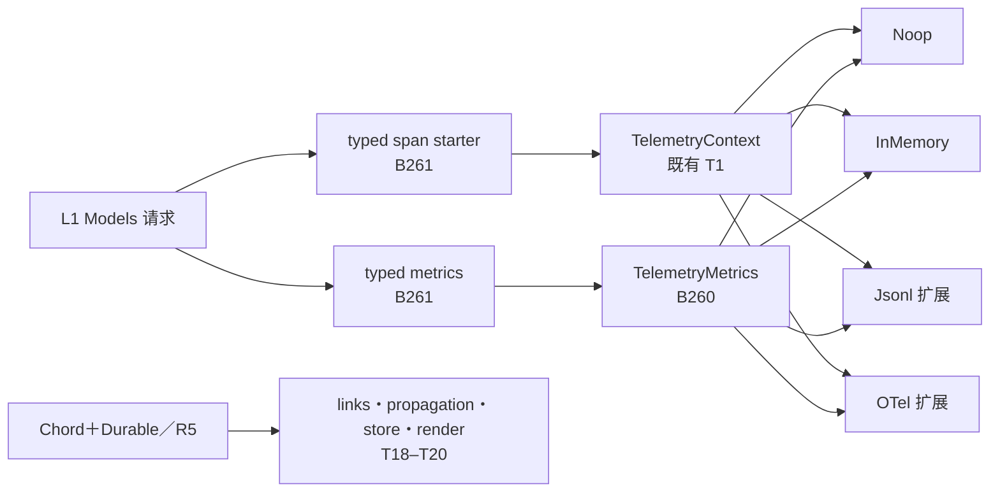
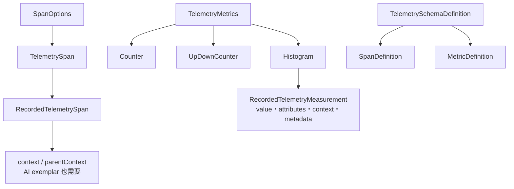

# 09 - L0 telemetry 新基线重测与实施设计

> 【状态】**已闭环（2026-11-01）：B260–B262 实施、独立终审修正与全仓 clean verify 均通过；L0 账面 36/36＝100%。**
>
> 【背景摘要】pi `56cae7823` 已把 telemetry 从旧“休眠契约”扩展为 AI 实际消费的 schema、span 与 metrics 面。pi-java 旧 100% 不可继承；实施前重测账面为 **31.0/36＝86.1%**，验收后为 **36/36＝100%**。

## 0. 范围、锚点与验证

- pi：`56cae782341c339d3bb820081f0f9425d8c5b1ec`，全部事实经 `git show` / 固定提交 `git grep` 取得。
- pi-java：`28e3f0d9b29b2a96cabb4109adb17a41cf39bf39`。
- 范围：T1–T17 全量重测；新导出按消费链补入 T18–T20；AI 只审 telemetry 边界，不做 L1 全量盘点。
- 基线实跑：`mvn test -pl pi-java-telemetry -am`，退出码 0，**53 测试／0 失败／0 错误／0 跳过**。
- pi 测试源码已逐件阅读但未在锚点执行；本文不声称跑过 pi 测试。新旧源码 diff 为 **15 文件、1619 插入、226 删除**。
- 逐行判定与权重：[`map/01-infra.md`](map/01-infra.md) A 节。B–D 的 protocol/client/server 旧快照不在本次重测范围。

### 实施前核心读数

| 口径 | 结果 |
|---|---:|
| 计分单元 | 17：对齐 12／存疑 4（T4/T9/T10/T14）／缺失 1（T11） |
| R5 出分母 | 3：T18 links/propagation、T19 store、T20 render |
| 加权 | **31.0/36＝86.1%** |
| 未加权 | **14/17＝82.4%** |
| 权重 3 子集 | **19.5/21＝92.9%** |
| 新开放工单 | B260／B261／B262（L0）；B263（L1 输入） |

## 1. 主线与数据结构

### 1.1 主流调用链



**主线**是 AI → schema/metrics → adapter。**支线**是 Chord＋Durable 等 R5 面的跨进程关联与查询；只记录公开接口和 consumer，不进入其内部实现。

### 1.2 核心数据关系



关键裁决：carrier 不只服务 Chord propagation。AI histogram exemplar 会把 span carrier 写入 measurement（`ai/test/telemetry.test.ts:139-153`），所以 **carrier 身份留在 B260/T9/T14，不随 T18 排除**。

## 2. 差异分类

| 类别 | 单元 | 结论 |
|---|---|---|
| 新增、主流计分 | T11、T14 新面 | AI 直接调用 typed schema/starter/metrics；旧 T11“全库零消费者”事实失效 |
| 修改、主流计分 | T4、T9、T10、T14 | 初始 `undefined` 过滤与快照隔离需补齐；InMemory 增 carrier/measurement；conformance 扩为 14/8；旧 Java 指标只有 long counter/timing |
| 新增、R5 出分母 | T18–T20 | T18 生产消费者为 Chord＋Durable，T19 为 Chord；T20 未见主流生产消费者，均属既定 R5 面 |
| 继续有效 | T1–T3、T5–T8、T12/T13/T15/T16/T17 | 基础跨度、状态、noop 基本行为及 Java 扩展件经两侧源码与 53 个 Java 测试复核 |
| 删除/清理 | 旧 T11 出分母裁决 | 撤销；不是删除功能。pi 删除的 Proxy 专用测试不强制删 Java 防护测试 |

### 两个账面纠错

1. pi 新套件为 **14 用例／8 组**。排除 links 2＋propagation 3 后，L0 可适用新增缺口只有 capabilities 1＋metrics 2。
2. Java 套件实际是 **7 用例／4 组**（`TelemetryAdapterConformance.java:37-59`），旧图“7/5”是汇总错账，不继承。

## 3. 范围裁决

### 3.1 AI 共享行为必须计分

- 【场景】metrics/schema 同时被 AI 与 Chord 使用，按文件名整包排除会漏掉主流缺口。
- 【决定】T9/T11/T14 进入分母，登记 B260/B261；AI 的 `pi.ai.*` 行为登记 B263，归 L1。
- 【风险/代价】[内部，模型不可见] L0 从旧 100% 降为 86.1%；换取真实主流账面。

### 3.2 R5 消费面出分母

- 【场景】T18 的生产消费者为 Chord＋Durable（含 `durable/src/harness/submissions.ts:107,241,257-260`、`scheduler.ts:2223,2238-2239`），T19 为 Chord；T20 未见主流生产消费者。它们虽位于公开 telemetry 包，但当前服务的是既定 R5 面。
- 【决定】本轮权重 0，不登记实施 B；AI 所需 carrier/exemplar 不捆绑排除。README 示例不作为生产接线证据。
- 【风险/代价】若 `bin pi` 主流后续直接消费 inject/extract、findTraces 或 renderTrace，必须原位重开 T18–T20；当前若误判会少算三个单元。

### 3.3 content-free 边界

- 【场景】AI 新遥测记录 block 大小与错误，不能把文本、thinking、工具参数、call id 或 deferred handle 泄漏进 Span。
- 【决定】L1 必须逐字钉住 content-free；Java 既有 `--trace-payloads` 是独立 opt-in JSONL 事件面，不把 payload 混入新 `pi.ai.*` Span 属性或小属性事件。
- 【风险/代价】[模型可见／用户可见] 错误消息只允许进入有界 status；attributes/events 中不得出现错误正文。

## 4. B260：记录语义、metrics、carrier 与 measurement

### 4.1 pi 逐字契约

`packages/telemetry/src/metrics.ts:20-41`：

```ts
export interface TelemetryCounter {
	add(value: number, attributes?: SpanAttributes): void;
}
export interface TelemetryUpDownCounter {
	add(value: number, attributes?: SpanAttributes): void;
}
export interface TelemetryHistogram {
	record(value: number, attributes?: SpanAttributes, context?: TelemetryContext): void;
}
export interface TelemetryMetrics {
	counter(name: string, options?: InstrumentOptions): TelemetryCounter;
	upDownCounter(name: string, options?: InstrumentOptions): TelemetryUpDownCounter;
	histogram(name: string, options?: HistogramOptions): TelemetryHistogram;
}
```

`memory.ts:52-61` 的 measurement 含 `kind/name/description/unit/boundaries/value/attributes/context`；`memory.ts:264-274` 记录原始 measurement，不聚合。`noop.ts:8-17` 共享三类 noop instrument，且不读取载荷。

### 4.2 拟增 Java 公共面

```java
public interface TelemetryMetrics {
    TelemetryCounter counter(String name, InstrumentOptions options);
    TelemetryUpDownCounter upDownCounter(String name, InstrumentOptions options);
    TelemetryHistogram histogram(String name, HistogramOptions options);
}

@FunctionalInterface
public interface TelemetryCounter {
    void add(double value, Map<String, Object> attributes);
}

@FunctionalInterface
public interface TelemetryUpDownCounter {
    void add(double value, Map<String, Object> attributes);
}

@FunctionalInterface
public interface TelemetryHistogram {
    void record(double value, Map<String, Object> attributes, TelemetryContext context);
}
```

- 为可选 options/attributes/context 提供 default 便捷重载；核心实现只有一个全参方法。
- `InstrumentOptions(description, unit)`、`HistogramOptions(description, unit, boundaries)` 用 record；boundaries 防御性复制。
- `MetricKind` 是纯常量闭集，用 `enum`；measurement 用 record。非法 NaN/负 counter 等输入与 pi 一样属于受信调用方契约，不新增运行时校验。
- `TelemetryContext.metrics()` 默认返回共享 `NoopTelemetryMetrics.INSTANCE`；root、span、settled 后 inert child 都保留同一 capability。
- 既有 `incrementCounter`/`recordTiming` 保留。Jsonl/OTel 的旧 override 与线格式不变；default 可桥到新 API，避免破坏既有自定义 adapter。

### 4.3 InMemory 语义

1. `InMemoryTelemetryContext implements TelemetryMetrics`，`metrics()` 返回 `this`。
2. 新增 `RecordedTelemetryMeasurement`，按记录序返回 detached 快照；数组 attributes、boundaries、context 均复制。
3. `RecordedTelemetrySpan` 增 `context` / `parentContext`；根 parentContext 为 null，child 继承 trace。**record 加组件必须搜索所有构造与归一化点**，包括 Jsonl conformance fixture，不只改生产构造器。
4. carrier 键逐字为 `pi-memory-scope` / `pi-memory-span` / `pi-memory-trace`；scope 用 UUID，本地 span id 自 1 自增。
5. 本包只生成/保存 carrier，**不实现 inject/extract、addLink、TelemetryStore**；这些仍属 T18/T19。
6. settled parent 的 inert child 不录跨度，但仍保留 metrics capability，直对新 `memory.ts:164-179`。
7. `SpanOptions` 构造初始 attributes 时不得直接 `Map.copyOf`：先按 `memory.ts:110-115` 过滤 null（≙`undefined`）并复制数组，保证合法初始 attributes 不在回调前抛 NPE；recording conformance 必须带 `ignored:null` 子场景。
8. `getSpans()` 必须逐 event 重建 `RecordedTelemetryEvent` 并重新 `copyAttributes`，不能只 `List.copyOf(events)` 复用内部事件。回归场景：事件 attributes 含 `String[]`，篡改第一次快照的数组后，第二次 getSpans 仍必须返回原值，直对 `memory.ts:441-461`。

### 4.4 Jsonl 与 OTel 扩展件

- Jsonl 新 generic metrics 使用独立 `kind:"metric"` 行，携带 metricKind/name/value/unit/attrs 及可用 exemplar；旧 `counter`/`timing` 行保持兼容。该线格式是 Java 扩展，无 pi golden。
- Jsonl conformance fixture 能读回 normalized measurements，不能只让 InMemory 通过新套件。
- OTel 映射 double counter/upDownCounter/histogram、attributes；own span 的 exemplar 使用对应 OTel `Context`，外部 context 不伪造 parent。
- 不新增 Maven 依赖。

## 5. B261：可序列化 schema 与 typed binder

### 5.1 必须保留的运行时行为

- `defineTelemetrySchema` 是 identity，返回同一对象且可 JSON 序列化（`index.ts:174-177`）。
- typed span starter 绑定显式 parent，并给 callback 一个绑定当前 span 的 child starter（`index.ts:427-456`）；不做运行时 schema/parent 校验。
- `createTypedMetrics` 合并 schema，并把 definition 的 description/unit/boundaries 传给 instrument factory（`metrics.ts:128-145`）。重复名的 TS 拒绝发生在编译期；Java 不擅自改成运行时异常。

### 5.2 Java 形状

- `TelemetrySchemaDefinition(version, spans, metrics)` 用 record。
- 属性定义因类型携带不同字段，使用 `sealed interface`＋record 变体；parent 定义同样使用 sealed ADT。纯 metric kind 用 enum。
- `TelemetrySchemas.defineTelemetrySchema(schema)` 返回同一引用。
- `TypedSpanStarter.startSpan(name, attributes, callback)` 委托现有 `startSpan`，callback 第二参为 child starter。
- `TypedTelemetryMetrics.counter/upDownCounter/histogram(name)` 从合并 schema 取 metadata 后委托 B260。

**已登记窄差 D201**：Java 无法复刻 TS 条件类型对 exact attributes、required keys、schema 名/仪器 kind 的编译期约束；保留运行时 identity、parent binding 和 metadata 行为，不增加 pi 没有的运行时校验。

## 6. B262：新版 adapter conformance

1. 对齐 pi `conformance.ts:44-386` 的 14/8 清单；R5 排除 links 2＋propagation 3。
2. Java 新增 capabilities 1＋metrics 2，形成 **10 用例／6 组**：9 个可适用 pi 案＋既有 Java 原子记录防护案。
3. `TelemetryAdapterFixture` 增可选 metrics/getMetrics；无 metrics adapter 可跳过 metrics 案，但 InMemory/Jsonl 两挂必须实跑。
4. capabilities 案断言 root/span/child/settled child 共享 metrics；不虚构 propagation capability。
5. 保留同步回调结构裁决：async rejection 仍并入同步可表达案，不制造 CompletableFuture 第二套契约。

## 7. B263：交给 L1 的 AI 输入

L0 不实现以下行为，但 L1 设计必须覆盖 `ai/src/telemetry.ts` 与 `ai/test/telemetry.test.ts`：

| 行为 | 新锚点断言 |
|---|---|
| Span 名 | `pi.ai.request`；每次 deferred poll 为 `pi.ai.poll` |
| attributes | provider/api/model/reasoning?；stop、四类 usage、cost.total、response.id? |
| events | first_chunk；text/thinking/tool_call block 只记类型、index、UTF-16 chars、tool 名 |
| metrics | request.duration、first_chunk.duration、tokens 四类、cost；pending/deferred poll 不计 token/cost |
| error | `provider_error`，错误消息最多 500 个 UTF-16 单元；缺失时为空串 |
| abort | status 保持 `ok`，`stop="aborted"`，errorMessage 不进入 attributes/events/status |
| 生命周期 | 包含 auth/setup；无需调用方消费事件也结束；instrument 按 metrics 对象缓存 |
| content-free | text/thinking/arguments/call id/deferred id/reasoning 非字符串值均不得泄漏 |

Java 当前只有 `PiLaneRequestTelemetry.java:58-101` 的 `llm.request`、`llm.*` 与两类 token，不能判为已覆盖 B263。

## 8. RED-first 与验收门

### 8.1 先写并观看失败

- B260：`SpanOptionsTest`（初始 attributes 含 null 时回调仍执行且该键缺席）；`InMemoryTelemetryContextTest`（事件数组经第一次快照篡改后，第二次 getSpans 仍隔离）；`TelemetryMetricsTest`（顺序、upDown、metadata、attributes、exemplar、detached snapshot、noop 不读载荷、settled child capability）；Jsonl/OTel 各新增真实 adapter 测试。
- B261：`TelemetrySchemaTest`（identity/JSON/child parent/no runtime validation）与 `TypedTelemetryMetricsTest`（metadata 合并与转发）。
- B262：先断言新 case 清单及 capabilities/metrics 三案，确认旧实现按预期失败，再补实现；不得只改 case 数量。
- B263/L1：使用锚点 secret 字符串逐字断言不泄漏；500/501 字符、missing error、abort、交错 tool delta、poll pending/deferred 分案。

### 8.2 获批实施后的命令

```bash
mvn test -pl pi-java-telemetry -am
mvn clean verify
```

要求测试零失败、Checkstyle 零错误零警告、SpotBugs 零新增问题；文件不超过 500 行，不使用 `@SuppressWarnings`。验证日志放在包工作区而非仅 `target/`。全部通过后才翻 T4/T9/T10/T11/T14；B263 不在 L0 翻行。

### 8.3 实施、终审与闭环证据

- B260–B262 均完成 RED-first；InMemory/Jsonl 各实跑 10 用例／6 组，telemetry 模块最终 **80 测试／0 失败／0 错误／0 跳过**。
- 独立终审的 OTel 可选 metadata、数组属性、schema optional 键、跨 recorder exemplar、JSONL payload null 元素与通用数组快照问题均新增回归并修复；late-null conformance 子场景已补齐。
- 生产／测试最大文件分别为 487／479 行，无 `@SuppressWarnings`；telemetry Checkstyle 零警告、SpotBugs 通过。
- 最终 `mvn clean verify`：16 个 reactor 项目全部 SUCCESS，**5772 测试／0 失败／0 错误／29 跳过**，总耗时 14:06。其他模块仍有 203 条既有 Checkstyle 警告，本次未改动其生产代码。
- 验收后 T4/T9/T10/T11/T14 翻为对齐，L0 为 **36/36＝100%**；B263 仍归 L1。

## 9. 未展开的黑盒、取舍与后续

- **AI lazyStream/Models 内部**：本包只读 observer 与测试，留给 L1，不以静态阅读推断其全部生命周期。
- **Chord SQLite store**：只核 consumer 名称与公开接口，未读存储实现；R5 不需要其实现细节。
- **JSONL payload sanitizer**：本次仅确认 opt-in 事件与 Span 小属性分离，不重审整个脱敏体系。
- **设计取舍**：不直接用新 generic metrics 替换旧 `incrementCounter`/`recordTiming` 线格式。那样代码更短，却会无收益地破坏现有 JSONL 消费者；采用旧面兼容、新面补齐。
- **审核门**：用户批准 B260–B262 的具体设计后才写 L0 代码；B263 需在 L1 单独取证、设计与批准。下一新文档号为 docs/10。
