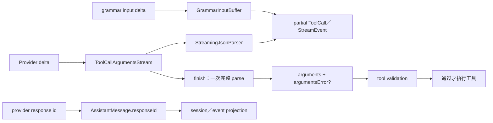

# 10 - L1 AI 新基线重测与流式工具参数设计

> 【状态】**已批准实施并闭环（2026-11-02）：B264 流式工具参数与消息形状工作包已完成；B263/B265/B266/B267 不在本次授权内，仍开放。**
>
> 【背景摘要】L0 telemetry 已闭环。L1 实施 B264 后账面为 **179.5/240＝74.8%**。本文的逐字契约、Java 设计和 RED-first 验收方案已全部落地。

## 0. 范围、锚点与基线

- pi：`56cae782341c339d3bb820081f0f9425d8c5b1ec`。所有 pi 事实从该提交的 `git show`、固定提交 `git grep` 或固定提交间 `git diff` 取得。
- pi-java B264 实施 HEAD：`d47c9551`。基线起点为 `28e3f0d9b29b2a96cabb4109adb17a41cf39bf39`。
- 范围：`docs/map/02-ai.md` 的全部计分单元、权重 0 排除项、新增主流行为与旧开放项。上层 agent-core、coding-agent、TUI 只做 docs/08 §10 允许的窄纵贯迁移。
- 首个实施设计包：流式工具参数与消息形状。模型目录、Client Identity、AI telemetry、Provider 与 OAuth 仍分别遵守后续设计审核门。
- R2 继续限制 Provider 范围；R5 继续排除 codemode、Durable、Chord 等面外子系统。共享主流行为必须按消费链单独判定。

### 0.1 可执行基线

```bash
mvn test -pl pi-java-ai -am
```

首次基线退出码 0，BUILD SUCCESS：

| 模块 | 测试 | 失败 | 错误 | 跳过 |
|---|---:|---:|---:|---:|
| telemetry | 80 | 0 | 0 | 0 |
| ai | 1753 | 0 | 0 | 0 |
| 合计 | 1833 | 0 | 0 | 0 |

总耗时 01:22。完整输出保存在 `.superpowers/sdd/08-pi-rebaseline-master-plan/l1-baseline-ai.log`。复审阶段以相同命令再次实跑，结果同为 1833 测试零失败、零错误、零跳过，BUILD SUCCESS，耗时 01:16；输出为 `l1-final-ai.log`。独立终审修正后第三次实跑仍为 1833 测试零失败、零错误、零跳过，BUILD SUCCESS，耗时 01:20；输出为 `l1-final-ai-after-review.log`。

pi 测试源码作为场景文档阅读，但本文不声称在固定锚点执行过 pi 测试。两侧行为判定以源码、测试和 Java 实跑为证据。

### 0.2 差异与规模

- 旧锚点 `ea448f454af474f3e2fe9733b331e17b0662f5d6` 到新锚点，`packages/ai` 有 258 个文件变化：82 新增、164 修改、10 删除、2 重命名。
- 差异量为 12347 行新增、6366 行删除。该数字包含生成目录和测试，不直接折算为功能缺口。
- 新锚点 pi：主源码 204 文件／28565 行，测试 192 文件／47691 行。
- 当前 Java：主源码 262 文件／31551 行，测试 224 文件／40354 行。
- AI 生产文件均不超过 500 行。既有四个测试文件超过 500 行：`CompatResolverTest` 528、`OpenAIResponsesApiTest` 727、`ThinkingFormatWireTest` 758、`ModelsJsonConfigTest` 1018。实施包若触及这些文件，必须先或同时拆分，不继续向超限文件追加测试。
- 当前 Jackson、provider SDK 与 L0 telemetry 依赖已覆盖首包设计方向，不预设新增 Maven 依赖。

### 0.3 旧账面的可复算基线

旧图实际逐行复算为 119 个计分单位，权重合计 223，得分 212，即 95.1%。旧图的 ContentBlock 域汇总、鉴权域汇总和存疑总数与逐行不一致。新图以逐行为唯一权威，不继承这些汇总错账。

新图有 131 个计分单位：对齐 79、存疑 17、缺失 35。脚本复算结果为 **159.5/240＝66.5%**；权重 1/2/3 分别为 39/57、50/78、70.5/105。完整证据见 [`map/02-ai.md`](map/02-ai.md)。

## 1. 主线与核心数据结构

### 1.1 主流调用链



`StreamingJsonParser` 只产生部分快照。终局参数必须再做一次完整解析。原始 JSON 和 parser 状态只存在于每个 provider 的调用状态，不进入 ContentBlock。

`JsonChange` 是公开增量镜像接口。`ToolCallArgumentsStream` 自身只使用快照，不消费 changes。两者都属 B264，避免只移植主线而漏掉固定锚点的公开导出。

### 1.2 数据所有权

| 结构 | 创建者 | 持有者 | 生命周期／可见性 |
|---|---|---|---|
| `StreamingJsonParser` | 每个 `ToolCallArgumentsStream` | 当前工具调用 | 内部；append 只读当前 delta |
| `JsonChange` | parser append | 公开调用方 | 不可变 set/append 变体；路径最深 32 |
| `ToolCallArgumentsStream` | provider stream state | 当前 provider slot | 每个调用独立持有 raw text、parser、最近快照；不进转录 |
| `ToolUseContent` | accumulator／终局 builder | AssistantMessage | 只含结构化 arguments 和可选 argumentsError |
| `GrammarInputBuffer` | grammar custom-call state | 当前 custom tool call | append delta、close authoritative full、initial unsent |
| `responseId` | 主流 provider 响应 | 两种 AssistantMessage／ImageResult | 本地响应元数据；不是本地消息 id |

## 2. B264 范围与边界

### 2.1 本包实施项

- 地图 #6/#9/#12/#18/#37/#64/#79/#103/#104/#109。
- 新增公开 `StreamingJsonParser`、`JsonChange`、`ToolCallArgumentsStream`。
- 六条现有主流车道的参数流：Anthropic、Completions、Responses、Mistral、pi-messages、Google；所有车道按 provider slot 隔离交错调用。Faux 只补本包需要的增量参数场景。
- Responses initial arguments、authoritative replace、重复 done 去重；Google 完整 args 的真实 JSON delta。
- `argumentsError` 的事件、消息、持久化和执行前校验纵贯传播。
- `responseId` 的六条 chat 车道与 OpenRouter Images 生产、消息形状、重建和持久化投影；B263 后续只消费它。
- whitespace-only 工具结果、多模态用户消息中的精确空 text、Anthropic 错误工具结果图片重排。

### 2.2 不在本包

- 跨模型 thinking 丢弃、transcript tools 三态：B265。
- managed/configuration_update effort、strict fallback、retry、OpenRouter cost、contentIndex、Gemini const：B267。
- ClientIdentity：B266。AI telemetry：B263。
- deferred provider 的完整实现和 Faux deferred 余量：后续设计。本包只保留 B263 所需的错误／参数事件边界。
- Bedrock、Codex、Vertex、Kimi 等 R2 面外车道。
- 不新增 Maven 依赖。使用现有 Jackson 和 provider SDK。

### 2.3 跨层编译与行为边界

【场景】给 record 增加 `argumentsError` 或 `responseId` 会改变规范构造器和 record 解构签名。只编译 AI 会让上层在全仓构建时失败；丢掉错误又可能让 malformed 工具调用继续执行。

【决定】B264 采用依赖顺序的窄纵贯迁移：AI 类型与解析 → agent-core 错误传播和 validation → coding-agent/protocol 的机械解构与线投影。docs/08 §10 已登记同一边界例外。只实现本包直接要求的错误执行门和持久化，不借机实施或翻转 L3/L4/L5 的其他行为与账面。

【风险/代价】[模型可见] malformed 调用不再通过 `_raw` 恢复执行，而是把错误返回给模型。这是本包有意的行为修正。[内部] 会触及多个 record 构造点；必须搜索构造、重建、withPartial、归一化、session codec 和 record pattern，不能只改规范构造器。

## 3. pi 逐字契约

### 3.1 ToolCall 与终局错误

`packages/ai/src/types.ts:444-456`：

```ts
export interface ToolCall {
	type: "toolCall";
	id: string;
	name: string;
	arguments: JsonObject;
	thoughtSignature?: string;
	namespace?: string;
	/** Set when the model's complete arguments text was not a valid JSON object. `arguments` is then `{}`. */
	argumentsError?: string;
}
```

`packages/ai/src/utils/json-parse.ts:106-119`：

```ts
export function parseToolCallArguments(json: string | undefined): Pick<ToolCall, "arguments" | "argumentsError"> {
	if (!json?.trim()) return { arguments: {} };
	try {
		const parsed = parseJsonWithRepair<ToolCall["arguments"] | null>(json);
		if (typeof parsed !== "object" || parsed === null || Array.isArray(parsed)) {
			throw new Error("Tool arguments must be a JSON object");
		}
		return { arguments: parsed };
	} catch (error) {
		return {
			arguments: {},
			argumentsError: `${error instanceof Error ? error.message : String(error)}\n\nReceived arguments:\n${json}`,
		};
	}
}
```

终局解析不能保留合法前缀。空白的完整输入是 `{}` 且无错误。数组、标量和 `null` 是错误。非对象错误的逐字前缀为 `Tool arguments must be a JSON object`，后接两个换行、`Received arguments:`、一个换行和原始文本。

pi 测试没有逐字钉住所有 V8 语法错误前缀。Java 可使用 Jackson 的语法错误前缀，但必须逐字满足非对象错误、分隔符和 raw suffix。已登记 **D202** 记录这一窄差；不得改变固定测试已经逐字钉住的部分。

### 3.2 增量 parser 与 JsonChange

`packages/ai/src/utils/streaming-json.ts:47-58,88-96`：

```ts
export type JsonPath = readonly (string | number)[];
export type JsonChange =
	| { readonly kind: "set"; readonly path: JsonPath; readonly value: JsonValue }
	| { readonly kind: "append"; readonly path: JsonPath; readonly text: string };

const MAX_REPORTED_DEPTH = 32;
const CREDIT_PER_APPEND = 256;
const CREDIT_PER_CHARACTER = 8;
const MAX_PENDING_SCALAR_LENGTH = 64;
```

`append()` 只读当前片段并顺序返回 changes。`snapshot()` 返回截至目前的普通 JSON 值。已经返回的快照之后不得改变。开放容器沿 open path 复制；完成容器和字符串可共享。

parser 对 malformed 流不抛异常。非法 escape 保留字面文本，未结束 escape 暂缓，缺失 comma/colon 容忍，无效位置的值和未知词丢弃，root 后的文本忽略。`NaN`/`Infinity` 词丢弃。重复键后者覆盖，`__proto__` 在 Java 中只是普通 Map 键。

### 3.3 每个调用的参数状态

`packages/ai/src/utils/streaming-json.ts:447-499`：

```ts
append(delta: string): ToolCall["arguments"] {
	this.#text += delta;
	this.#parser.append(delta);
	return this.#partial();
}

replace(text: string) {
	if (text.startsWith(this.#text)) {
		const delta = text.slice(this.#text.length);
		return { delta, arguments: delta === "" ? this.#partial() : this.append(delta) };
	}
	this.#text = "";
	this.#parser = new StreamingJsonParser();
	return { delta: undefined, arguments: this.append(text) };
}

finish() {
	return parseToolCallArguments(this.#text);
}
```

`replace` 的前缀扩展只消费缺失尾巴。非前缀完整文本会重置 parser，但不创造对外 delta。Responses 在 `function_call_arguments.done` 可发布返回的尾巴；随后的 `output_item.done` 再调 `replace` 更新状态，但不得重复发布同一尾巴。

### 3.4 Grammar append 与 close

`packages/ai/src/api/constrained-sampling.ts:191-235` 的关键变化：

```ts
export function appendGrammarToolInputJsonDelta(buffer, inputProperty, inputDelta) {
	if (buffer.closed) throw new Error(`grammar tool input for property "${inputProperty}" changed after it was closed`);
	if (inputDelta.length === 0) return undefined;
	buffer.input += inputDelta;
	return grammarToolInputJsonStart(buffer, inputProperty) + JSON.stringify(inputDelta).slice(1, -1);
}

export function closeGrammarToolInputJson(buffer, inputProperty, finalInput) {
	if (buffer.closed) {
		if (finalInput === undefined || finalInput === buffer.input) return undefined;
		throw new Error(`grammar tool input for property "${inputProperty}" changed after it was closed`);
	}
	if (finalInput !== undefined && !finalInput.startsWith(buffer.input)) {
		throw new Error(`grammar tool input for property "${inputProperty}" changed non-monotonically`);
	}
	const rest = finalInput === undefined ? "" : finalInput.slice(buffer.input.length);
	if (finalInput !== undefined) buffer.input = finalInput;
	buffer.closed = true;
	return `${grammarToolInputJsonStart(buffer, inputProperty)}${JSON.stringify(rest).slice(1, -1)}"}`;
}
```

append 的输入是 delta，不是截至目前的完整字符串。close 可接受权威完整输入。关闭后的任何 append 都抛错，包括空 delta。相同 close 幂等；不同 close 抛错。

## 4. Java 现状与拟改 API

### 4.1 已证实的主要缺口

- `AI/stream/ToolCallBlockAccumulator.java:93-106` 每个 delta 都对全部 raw 重新 parse；`:142` 终局再次 parse。
- `AI/stream/ToolArgumentParser.java:18-23` 失败时返回 `_raw`，并开启 comments/single quotes/unquoted names/trailing comma。它不是固定终局契约。
- `AI/message/ContentBlock.java:115-133` 和 `AI/stream/StreamEvent.java:221-233` 没有 `argumentsError`。
- `AI/protocol/GrammarInputBuffer.java:36-63` 仍接收 cumulative input＋close boolean。
- `AI/protocol/ResponsesStreamProcessor.java:131-147` 没有把 initial item arguments 送入同一参数状态。
- `AI/protocol/GoogleGenerativeAiApi.java:269-280` 读取了完整 args，却发送空 delta。
- `AI/message/Message.java:165-168` 的 responseId 排除理由已经失效。固定锚点的 Anthropic、Google、Mistral、Completions、Responses、pi-messages 都生产它，`telemetry.ts:190` 消费它。
- `pi-java-agent-core` 的 `ToolArgumentsValidator.java:53-62` 允许 `_raw` 绕过 required 校验，`PiLoopTools.java:118-120` 丢弃错误元数据。

### 4.2 新 streaming 类型

在 `com.pijava.ai.stream` 增加公开类型；每个文件保持不超过 500 行：

```java
public sealed interface JsonChange {
    record Set(List<Object> path, Object value) implements JsonChange {}
    record Append(List<Object> path, String text) implements JsonChange {}
}

public final class StreamingJsonParser {
    public List<JsonChange> append(String delta);
    public Object snapshot();
    public boolean hasValue();
}

public final class ToolCallArgumentsStream {
    public record Finish(Map<String, Object> arguments, String argumentsError) {}
    public record Replacement(String delta, Map<String, Object> arguments) {}

    public String text();
    public Map<String, Object> append(String delta);
    public Replacement replace(String completeText);
    public Finish finish();
}
```

`JsonChange` 的 path 元素只准许 String 或 Number，构造时复制并限制深度。`snapshot()` 的 Java null 同时可能表示“尚未开始”和 JSON null；`hasValue()` 在 root 已开始（包括 JSON null）时返回 true，调用方不得靠非对象终局规则混淆两者。所有 nullable 返回值使用项目既有 JSpecify 标注，不新增 `@SuppressWarnings`。

快照必须深度不可变或深度独立复制。新增 `JsonSnapshots` 深度复制 JSON object/array：保留插入顺序和 null，使用可含 null 的 LinkedHashMap/ArrayList 加只读包装，不能用 `Map.copyOf`/`List.copyOf`。parser、`ToolUseContent`、`ToolCallEnd`、`PiToolCall` 都统一使用该 helper，修复当前构造器对合法 `{"value":null}` 和 nested list null 的 NPE。`ToolCallArgumentsStream.append("")` 在快照未变时返回同一 arguments 对象。

终局 parser 使用严格 JSON＋固定 repair 家族：raw string control 转义、非法 escape 反斜杠加倍及 malformed `\u` 处理。不得继续开放 comments、single quotes、unquoted names、trailing comma，也不得接受合法前缀。

### 4.3 消息与事件记录

```java
ContentBlock.ToolUseContent(
    String id, String name, Map<String, Object> arguments,
    String thoughtSignature, String namespace, String argumentsError)

StreamEvent.ToolCallEnd(
    int contentIndex, String id, String name, Map<String, Object> arguments,
    String namespace, String argumentsError, AssistantMessage partial)
```

- 新组件可空，JSON 省略 null。保留既有便捷构造器并委托 null。
- `StreamEvent.withPartial`、`ToolCallBuilder.toEnd`、所有 accumulator end 重载、PiMessages 投影和 record pattern 同步更新。
- streaming `AssistantMessage` 与 domain `Message.AssistantMessage` 都增加 nullable `responseId`，放在末尾 optional 组件以减少构造歧义。保留既有构造器。`ImageResult` 同样在末尾增加 nullable `responseId`，保留旧六参构造器；`OpenRouterImagesApi.java:77-78` 从真实 ChatCompletion response id 填充，固定证据为 `openrouter-images.ts:87` 与 `types.ts:675`。
- `TransformMessages` 的 toolCall 两个复制分支保留 `argumentsError`；`SessionJson`、`MessageJsonCodec`、web/protocol 投影保留 `argumentsError` 和 `responseId`。
- 出站 provider 重放只发送 arguments。`argumentsError` 用于本地验证和反馈，不作为额外 provider JSON 参数发送。

responseId 的生产时序按车道固定，不用一个含糊的“最后值”规则：

- Anthropic 在 `message_start` 赋 `event.message.id`。
- Completions、Mistral、Google 只接收首个非空值，对应固定 `||=`。
- Responses 在 `response.created` 赋值，并在 terminal response finalization 再按权威响应赋值。
- pi-messages 从 done/error envelope 赋值；OpenRouter Images 从最终 image response id 赋值。

`StreamPartialBuilder` 增加 responseId 状态与 assign/first-nonblank 两种明确方法，`snapshot()` 必须携带。`AssistantMessage.java:125-218` 全部 wither、`Message.java:275-293,337-352` 的 fromPartial/withStopReason/withThinkingLevel、`TransformMessages.java:249-254`、`ContextEntries.java:263-269`、`LlmSummaryGenerator.java:270-272,433-439` 和全部 codec/projection 必须保留该字段。禁止让既有重建点经过会把 responseId 默认成 null 的兼容构造器。

### 4.4 Provider 状态机与交错调用

现有 `ToolCallBlockAccumulator.java:17-31` 只有一份 raw buffer、identity、namespace 和 block index；`ToolCallAccumulator.java:25-26` 也明确承认 single-tool-call 限制。B264 必须先消除这个前提，不能把单 slot 换成单 parser 后仍继续交错串写。

```java
record ToolCallSlotKey(String providerIndex, String idFallback) {}
final class ToolCallSlot {
    ToolCallArgumentsStream arguments;
    GrammarInputBuffer grammar;
    String id;
    String name;
    String namespace;
    int blockIndex;
}
```

- `StreamPartialBuilder` 持有 `Map<ToolCallSlotKey, ToolCallSlot>`。provider stream/output index 是主键；只有该车道没有 index 时才使用文档化 id fallback。key 不进入 ContentBlock。
- start/delta/replace/end 都显式携带 slot key。每个 slot 独立保存 raw text、parser、grammar、identity、namespace 和 block index；end 只终结并移除对应 slot。
- `ToolCallAccumulator` 在 Completions/Mistral/Responses/pi-messages 处理器中同样按 provider index 分 slot。Mistral 删除 `MistralSseProcessor.java:196-207` 与 shared builder 的重复 raw 累积，每个 delta 只进入所属 slot 一次。
- start 初始化空流和 `{}` block。delta 只 `append(delta)` 一次，并发送原始 delta。流结束时仍在 start 状态的 slot 按开始顺序 finish；空 raw 得到 `{}` 且无错误。
- Responses 增加 `seedToolArguments(slot, initial)`。它更新部分快照，不自行发布 delta。`replaceToolArguments` 返回可选 `ToolCallDelta`；arguments.done 发布非空尾巴，output_item.done 忽略返回事件。
- Google 对完整 args 先序列化为真实 JSON delta，再让所属 slot finish；不得发送空串。
- pi-messages 增加 authoritative terminal finish。它先用 `replace` 判断是否还需发布尾巴，再直接以 terminal toolCall 的 id/name/arguments/argumentsError/thoughtSignature/namespace 重建 block 和 end event；不得重新 parse 已累积 raw。非前缀 valid arguments 也必须完整替换。固定证据：`pi-messages.ts:280-287` 的 `Object.assign(partial.content[index], event.toolCall)`。
- GrammarInputBuffer 改为 `appendDelta(String)` 和 `close(String finalInput)`。每个 Responses custom-call slot 独立保存 initial `unsent`，只在首个对外 append/close 拼接一次。
- 原始 JSON、`partialJson`、`partialArgs`、stream index 和 parser internals 不进入 ContentBlock。只有终局 `argumentsError` 按 pi 契约故意携带 raw arguments。

### 4.5 执行前校验和 legacy `_raw`

`PiLoop.ToolCall`／`PiToolCall` 增加 nullable `argumentsError`，`PiLoopTools` 逐字段传递。新增：

```java
ToolArgumentsValidator.validate(schema, args, toolName, argumentsError)
```

当 error 非空时，先于 schema 校验抛出：

```text
Invalid arguments for tool "<name>": <argumentsError>
```

`PiToolRunner.prepare` 把该失败转成工具错误结果，counting tool stub 必须证明 `execute()` 未调用。保留 map-only overload 给旧调用方，但新生产链必须走全参方法。

fresh stream 不再产生 `_raw`。`_raw` 本身仍是合法 JSON 属性，不能在 decode 时全局保留字化或 blanket-migrate。仅对旧版 **BashTool 专用恢复路径** 的精确 singleton `{"_raw":"..."}` 形状做迁移：在执行前用同一个 final parser 处理 raw，失败则生成 `argumentsError`，不得执行。其他 custom tool 的 `_raw`（包括 singleton）始终按普通合法参数处理。旧会话无法任意区分 fallback 与合法属性，因此以“旧 Bash 专用消费者＋精确形状”为唯一兼容边界；新增 validator 和 Bash recovery 的特殊绕过全部删除。

### 4.6 其他消息形状

终局 blank arguments 与三车道的 `trim().length` 统一使用 `EcmaWhitespace.isEmpty(String)`。仅把 ECMAScript WhiteSpace／LineTerminator 码点视为空白：0009–000D、0020、00A0、1680、2000–200A、2028/2029、202F、205F、3000、FEFF。不得改用 Java `trim()` 或 `isBlank()`；谓词只判断空与非空，实际非空正文保持原样。

- Completions 与 Responses 在没有任何图片时使用 `(no tool output)`。Completions 在只有图片时使用 `(see attached image)`。Responses 在模型不支持图片或图片缺席时使用对应文本；支持图片时输出图片块，不额外发明文本。固定证据：`openai-completions.ts:1402-1416`、`openai-responses-shared.ts:83-109`。
- Google 在无正文但有图片时使用 `(see attached image)`；无正文且无图片时使用空串。固定证据：`google-shared.ts:286-316`。三车道都以 `textResult.trim().length > 0` 判断有无正文，但不修改实际非空白正文。
- Completions 多模态 user 数组逐块丢弃 `TextContent("")`，再判断数组是否为空。不要把 whitespace 一并 trim。
- Anthropic 在同一连续 toolResult 组内处理错误结果。每个连续图片段替换为 `(image attached after the tool results)`；如果前一个文本块已经逐字等于该 placeholder，也不再重复插入。随后在本组全部 tool results 后追加 caption＋图片。固定 `transform-messages.ts:12-57`：

```ts
const ERROR_TOOL_IMAGE_PLACEHOLDER = "(image attached after the tool results)";
caption: `Images from the error result of tool call ${msg.toolCallId} (${msg.toolName}):`,
```

固定 `anthropic-messages.ts:1497-1520` 的合并顺序逐字为：

```ts
params.push({
	role: "user",
	content: [...toolResults, ...errorImages],
});
```

- responseId 只从真实 provider 响应填充。不得用本地 message id 或 call id 代替。

## 5. 必须保持的状态迁移

```text
START(raw="", partial={}, error=null)
  append(d)              -> raw+=d；parser只读d；partial=最新对象快照
  replace(prefix full)   -> 内部只消费缺失尾巴；可返回该尾巴一次
  replace(non-prefix)    -> reset raw+parser；读完整文本；不返回新delta
  finish(blank)          -> arguments={}；error=null
  finish(valid object)   -> arguments=完整对象；error=null
  finish(other/malformed)-> arguments={}；error=错误+Received arguments+raw

GRAMMAR INIT
  append("")             -> 无输出，不启动对象
  append(d)              -> 只转义d；前缀仅首次输出
  close(full)            -> full必须延续input；只输出缺失suffix和结束括号
CLOSED
  close(same/absent)     -> 无输出
  close(changed)         -> exact error
  append(any,含空)        -> exact error
```

## 6. RED-first 验收

### 6.1 Parser 与 finalization

1. 固定 `streaming-json.test.ts` 的嵌套 JSON 每个切分点、container/member 未完成、literal/number 边界。
2. `JsonChange` mirror：set/append 顺序、split escape、nested container、深度 32、pending scalar 64、copy credit。
3. 旧快照矩阵：保留每次返回的 Map/List，后续 append 不得改变任何旧快照；`{"value":null}` 与 nested list null 必须经过 parser→event→message→session，全程不抛 NPE、不丢 null。
4. 非法／合法 Unicode：`é`、`\u12`、`\uZZZZ`、`\usepackage`、raw newline/NUL、跨 delta surrogate pair。
5. malformed streaming 不抛异常；missing comma/colon、unknown words、trailing root、duplicate keys、`__proto__`。
6. 大参数流证明每 delta 只读一次。用输入计数和分配上界为主，不用脆弱 wall-clock 作为唯一门禁。
7. finish 对 blank、valid、array/scalar/null、合法前缀后 malformed 分案。合法前缀不得保留；raw suffix 逐字。
8. prefix replace 只返回尾巴一次；non-prefix replace 重置但不发 delta。

### 6.2 Grammar 与 provider

9. append delta、empty append、close full、same/changed close、closed 后空/非空 append。
10. Responses `added(initial)→delta→arguments.done(full)→output_item.done(full)` 每段恰好一次；pi-messages 分别以 non-prefix valid、malformed terminal 验证权威终值全字段替换且不重复发尾巴。
11. Anthropic/Completions/Responses/Mistral/pi-messages 共用 malformed 与 content-free shape oracle；不得出现 `_raw` 或 parser 内部键。Completions/Mistral/Responses/pi-messages 分别跑 A-start→B-start→A-delta→B-end→A-end，证明参数、身份、namespace、grammar 和 block index 不串 slot；再覆盖 open-call 空参数 finish。
12. Google 完整 args 的 delta 等于固定 JSON 序列化，终局等于原结构化对象。
13. 六条 chat 车道分别验证 responseId 的 assign／first-nonblank／terminal 时序；OpenRouter Images 验证 ImageResult.responseId。缺失时保持 null，不用本地 id 代替。
14. 既有 Responses 测试需要新案时新建不超过 500 行的专项文件，不继续追加到既有 727 行 `OpenAIResponsesApiTest`。

### 6.3 纵贯与消息形状

15. malformed call 返回逐字工具错误，counting tool 证明未 execute；schema 无 required 时也不得绕过 error。
16. 旧 Bash singleton `_raw` 走 final parser 并拒绝 malformed；合法 custom-tool `_raw`（含 singleton）照常校验和执行；fresh stream 永不合成 `_raw` fallback。
17. `argumentsError`／`responseId` 经 TransformMessages、SessionJson、MessageJsonCodec、RPC/web 投影往返不丢失；逐项断言 snapshot、所有 wither、fromPartial、withStopReason、withThinkingLevel、ContextEntries、LlmSummaryGenerator 保留 responseId；record pattern 全仓编译。
18. whitespace-only 工具结果覆盖普通空白、NBSP、BOM 和非 ECMAScript 空白反例；精确空多模态 text、连续图片 placeholder 去重、既有同文 placeholder 去重、错误图片在连续工具结果组后的顺序分别使用固定 oracle。
19. B263 预备：telemetry 不得读取 arguments 来获取错误；错误原文只能存在规定的本地 validation/session 面，不进入未来 `pi.ai.*` Span。

每项先写最小测试并观看正确失败，再写实现。行为修复若只改测试而没有先观察到 RED，不计入闭环。

## 7. 验证门与文件约束

```bash
mvn test -pl pi-java-ai -am
mvn test -pl pi-java-agent-core,pi-java-coding-agent -am
mvn clean verify
```

- 全部通过后才翻 B264 对应地图行；B263/B265/B266/B267 不随本包翻行。
- 文件均不超过 500 行，不新增 `@SuppressWarnings`。触及四个既有超长测试文件时先拆分。
- 模型可见分隔符、非对象错误、工具校验文案和结果占位符逐字断言。必要时从固定 pi 提交运行 TS 生成 golden，并记录命令；不得用 Java 自产 golden 自证。
- 最终要求测试零失败，本包改动文件 Checkstyle 零错误零警告，全仓 Checkstyle 零错误、SpotBugs 零新增问题；既有警告单列，不虚报清零。验证日志放在本计划工作区。

## 8. 裁决、取舍与风险

### 8.1 JsonChange 纳入首包

【场景】生产 ToolCallArgumentsStream 不消费 JsonChange，但固定 `src/index.ts:44` 公开导出整个 streaming-json 面。

【决定】首包实现 parser append/snapshot 与 JsonChange，不把公开面另造一个权重 3 的重复缺口。

【风险/代价】[内部] 增加 mirror 和深度测试工作量；换取公开 API 与主线同时稳定。

### 8.2 Jackson 语法错误前缀

【场景】V8 与 Jackson 对任意 malformed JSON 的语法错误措辞不同。pi 测试只逐字钉住非对象错误和 raw suffix。

【决定】保留 Jackson 前缀，逐字实现已钉部分，登记 D202。不得因此放宽 `{}`＋error 或 raw 原文契约。

【风险/代价】[模型可见] 某些 syntax error 首句不同；工具仍能收到准确原文和失败原因。若用户要求全部 V8 文案逐字，需要另写兼容层，不在首包暗中承诺。

### 8.3 不重复计分

【场景】同一 streaming/identity/effort 缺口可同时出现在粗 wire/provider 行和细行为行。

【决定】按 map/02 的唯一责任行扣分。OpenRouter 动态目录归 provider#16，不另增新行；provider-reported cost 与目录 calculateCost 分行。

【风险/代价】[内部] 账面依赖公开边界；若责任行判断错误会改变百分比，但不会遗漏已登记的实际工单。

## 9. 后续工作包与未展开黑盒

- B265：目录生成物不在固定 commit。必须选择 pinned published artifact，或固定 generator＋固定 models.dev/OpenRouter/Radius 输入快照。不能用当日网络结果冒充 `56cae7823`。
- B266：Identity 需要 tri-state attribution，区分“未指定”与“显式 null”。详细设计时再决定 JVM runtime 文案窄差。
- B263：复用 L0 schema/metrics/carrier。请求文本、thinking、工具参数、call id、deferred id 不得进入 Span。B264 的 `argumentsError` 也不得被复制进 Span。
- B267：按依赖拆 Provider、usage、OAuth 等设计；`noRetryStatuses` 唯一消费者仍是 classifier/R5，不擅自扩面。
- 黑盒：provider SDK 内部、完整 deferred provider、上层 agent/coding-agent/TUI 生命周期、MCP/Chord。本文只核与本包相交的公开接口。
- 证据限制：pi 测试未在锚点执行；Java 基线已实跑。任何新行为只有在获批实施后完成 RED→GREEN 和全仓验证才可翻为对齐。

## 10. 实施与闭环记录

### 10.1 已实施

- `401e8447`：增量 `StreamingJsonParser`、`JsonChange`、`JsonSnapshots`、`FinalToolArguments`、`ToolCallArgumentsStream` 与 ECMAScript 空白谓词。
- `0cc134d7`：`argumentsError`／`responseId` record 形状；TransformMessages、SessionJson、MessageJsonCodec、compaction、RPC/web 破坏性字段丢失点全部补齐；循环 JSON 输入改为快速拒绝，修复上层 OOM。
- `07c23492`：`ToolCallSlotKey` 与每 provider slot 隔离；Completions/Mistral/Responses/pi-messages/Google/Anthropic 的增量参数、grammar、authoritative terminal、responseId 与 OpenRouter Images/Faux 增量事件。
- `5b44e3eb`：`argumentsError` 先于 schema 的执行门；counting tool 证明 malformed 不执行；legacy `_raw` 仅限 `bash` 的精确 singleton，共用 final parser。
- `d47c9551`：三车道 whitespace-only 工具结果、Completions 精确空 text、Anthropic 错误工具结果图片组尾重排。

每项均先运行 RED 再实现；Mistral 分片空 name、Anthropic 无图错误结果 join 形状两处由全量回归抓回并补回归门。

### 10.2 验证证据

- `mvn test -pl pi-java-ai -am`：telemetry 80＋AI 1,811，零失败／错误／跳过。
- `mvn test -pl pi-java-agent-core,pi-java-coding-agent -am`：AI 1,811＋MCP 260＋agent-core 924（1 跳过）＋session 37＋coding-agent 1,769；零失败／错误，BUILD SUCCESS。
- `mvn clean verify`（2026-11-02 00:30，评审修正前，20:09 min）：BUILD SUCCESS，5,843 测试、0 失败、0 错误、29 跳过。分模块：telemetry 80、AI 1,808、MCP 260、agent-core 924（1 跳过）、session 37、coding-agent 1,768、TUI 624（1 跳过）、protocol 14、server 2、web 61、evals 196（27 跳过）、examples 69。
- 评审修正后重跑最终 `mvn clean verify`（2026-11-02，18:25 min）：BUILD SUCCESS，5,847 测试、0 失败、0 错误、29 跳过。分模块：telemetry 80、AI 1,811、MCP 260、agent-core 924（1 跳过）、session 37、coding-agent 1,769、TUI 624（1 跳过）、protocol 14、server 2、web 61、evals 196（27 跳过）、examples 69。

### 10.3 账面与后续

map/02 只翻 B264 责任行 #6/#9/#12/#18/#37/#64/#79/#103/#104/#109：L1 由 159.5/240＝66.5% 变为 **179.5/240＝74.8%**。B263/B265/B266/B267 未翻行。D202（V8 与 Jackson syntax error 前缀窄差）继续挂账，不影响 malformed 的 `{}`＋原文契约。

### 10.4 独立评审与处置

fresh-context 全分支评审覆盖 `28e3f0d9..dcf23290`（评审修正提交为 `3f0a4e4b`）：

- **Important，已修正**：Anthropic 车道仍用全局 pending id/name，第二个并行 `tool_use` 的 start 会覆盖第一个；index 0 的 delta 落到第二个工具，参数串写成 `{"a":1}{"b":2}`，随后第二个 stop 报槽位错误。改为按 `content_block.index` 记录 open block，并用同一 index 作 `ToolCallSlotKey`（pi `openBlocks`，anthropic-messages.ts:730-815）。RED：`interleavedToolBlocksKeepTheirOwnArgumentSlots`。
- **Important（评审记 Minor，按影响重判），已修正**：B264 的深不可变 `arguments()` 让 before_tool 扩展无法原地改写嵌套容器；扩展抛 `UnsupportedOperationException` 后被转成工具错误、调用不执行，违背 pi `event.input` 可变契约（types.ts:1474-1483）。桥接层改为深可变复制。RED：`handlersCanMutateNestedArgumentsInPlace`。
- **Minor（按影响重判为 Important），已修正**：Mistral 并行调用缺 `index` 时全部塌进槽 `"0"`，两个调用的参数被拼成非法 JSON、其中一个丢失；缺 id 或字面 `"null"` 时也不按 pi 派生。改为 `key = index ?? callId` 与 `derive("toolcall:<index>")`（mistral-conversations.ts:712-718）。RED：`parallelToolCallsWithoutIndexUseTheirIdsAsSlots`、`missingOrNullToolCallIdsAreDerivedFromTheIndex`。
- **Minor，挂账不修**：Anthropic 多文本错误结果附加图片后，线上 `content` 是 block 数组，pi 是 `"\n"` 连接的字符串；Anthropic 两种形状都接受，文本内容等价（`AnthropicMessageConverter`）。
- **Minor，挂账不修**：Responses `custom_tool_call` 的 `input` 在 added 帧走 SDK 严格访问器，非规范端点缺字段会抛 `OpenAIInvalidDataException`；pi 用 `item.input || ""`（`ResponsesCustomCalls`）。
- **Minor，挂账不修**：L0 的通用 `TelemetryAdapterConformance` 只接到 InMemory 与 JSONL，OTel/Noop 仍只有专项测试；无运行时缺陷。
