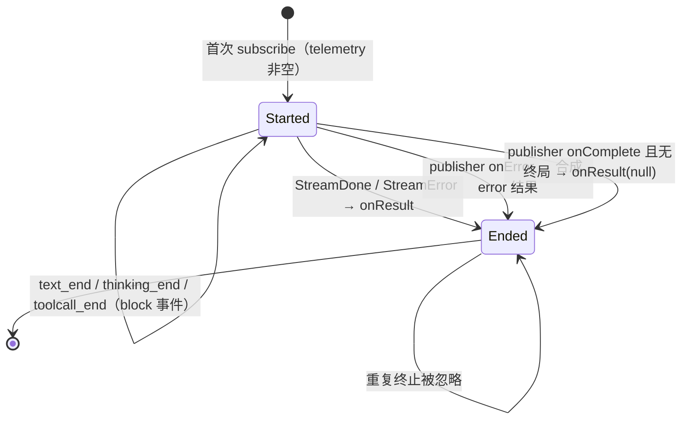

# 13 - L1 AI 请求遥测对齐设计（B263）

> 【背景摘要】这是 L1（ai 模块）在固定锚点 `56cae7823` 下的第四个实施包设计稿。B264（流式工具参数）、docs/11（行为面）、docs/12（目录数据与运行时）已闭环。本稿接手 B263：把 pi 的 `AI_TELEMETRY_SCHEMA`、`pi.ai.request`/`pi.ai.poll` 跨度、content-free 块事件、请求/首块直方图、四类 token counter、cost counter、`provider_error` 与 abort 语义移植到 `pi-java-ai`。
>
> **文档状态：用户已审核通过（2026-11-02），已实施并闭环（2026-11-03）。闭环记录见 §10。**

## 0. 范围、锚点与基线

### 0.1 锚点与基线

| 项 | 值 |
|---|---|
| pi 目标锚点 | `56cae782341c339d3bb820081f0f9425d8c5b1ec` |
| pi 证据路径 | 固定提交的 `packages/ai/`；只用 `git show 56cae7823:<path>` 取证 |
| pi-java 当前 HEAD | `2c048dd7`（本稿写作时） |
| 可执行基线 | docs/12 终态：`mvn clean verify` 实测 **5,901 测试／0 失败／0 错误／29 跳过**；Checkstyle 0；SpotBugs 0 |
| 本包终态 | `mvn clean verify` 实测 **5,937 测试／0 失败／0 错误／29 跳过**；Checkstyle 0；SpotBugs 0；总耗时 15:50 |
| 新文档号 | 本稿占 `docs/13`；下一新文档号为 `docs/14` |

> 行号口径：`AI/` 表示 `pi-java-ai/src/main/java/com/pijava/ai/`；其他模块写完整路径。Java 行号以 `2c048dd7` 工作树为准。

### 0.2 为什么先做 B263

【场景】L1 还剩三个开放工单：B263（AI 请求遥测）、B266（ClientIdentity）、B267（provider wire／usage／retry／OAuth／CLI 权限／Faux 的混合包）。B267 的条目之间没有共同实现面，必须先拆；B266 会同时改请求头、身份合并和 Models 包装器，面比 B263 宽。

【决定】docs/13 只接 B263（地图 #106）。理由有三条：

1. 它只依赖刚刚闭环的 L0 telemetry primitives（docs/09：schema、typed starter、typed metrics、InMemory exemplar、openSpan）；
2. 它只需要一个 `ApiOptions` 字段和一个观察者，不碰 provider wire、鉴权或宿主层；
3. docs/09 §7 已经把 B263 的输入清单逐条交给 L1，边界已经画好。

【风险/代价】[内部，模型不可见] L1 的账面只前进 1 个权重点。换来的是 telemetry 的 AI 消费面先稳定，B266 在请求头与身份面复用时不必再动这套 schema。

### 0.3 本包计分单元

| 地图行 | 能力 | pi 证据 | Java 证据 | 当前判定 | 权重 | 目标 |
|---|---|---|---|---:|---:|---|
| #106 | AI request／poll telemetry | `src/telemetry.ts:9-205`；`src/api/lazy.ts:32-85`；`src/models.ts:901-975` | 无 `pi.ai.*`；只有 agent-core 自己的 `llm.*`（`pi-java-agent-core/.../PiLaneRequestTelemetry.java:58-102`） | 缺失 | 1 | 对齐 |

账面影响（已于 2026-11-03 闭环后翻）：

| 口径 | 当前 | 闭环后 |
|---|---:|---:|
| 加权 | 195.0/240＝81.25% | **196.0/240＝81.67%** |
| 未加权 | 104.5/131＝79.8% | **105.5/131＝80.5%** |
| 对齐／存疑／缺失 | 97／15／19 | **98／15／18** |
| 权重 1 子集 | 45/57＝78.9% | **46/57＝80.7%** |
| 新增单元域 | 5/16＝31.3% | **6/16＝37.5%** |

### 0.4 不在本包

- **B266 ClientIdentity**：tri-state merge、User-Agent、归因头、Models wrapper。本包不读写身份头。
- **B267 的其余面**：provider wire、usage 字段（#53/#59/#107）、retry／overflow、OAuth／device／env、pi-ai CLI 权限、Faux 余量。
- **宿主层接线**：不把 `pi.ai.*` 接到 agent-core／coding-agent，也不改 `StreamOptions`、`HarnessConfig`、`llm.*`。理由见裁决 4。
- **deferred fetch 入口**：Java 的 `StreamApi` 没有 `streamDeferred`／`fetchDeferred`。本包只实现观察者的 poll 分支并用单测覆盖；真实入口留给 B267 #75，登记 D203。
- **错误消息内存占用测试**（pi `telemetry.test.ts:201-219`）：那是 V8 子串视图的内存特性；JVM 的 `String.substring` 自 JDK 7u6 起复制字符数组，无对应行为，不移植。
- **非标量 native reasoning 测试**（pi `telemetry.test.ts:221-245`）：Java 的 `StreamRequest.reasoning()` 是类型化 `Optional<ThinkingLevel>`，不存在对象形态。见裁决 7。
- 不新增 Maven 依赖；不改 `pi-java-telemetry` 的公共契约。

### 0.5 术语

- **span（跨度）**：一次可计时的操作区间。本包两个名字：`pi.ai.request`（一次逻辑模型请求）与 `pi.ai.poll`（一次 deferred 轮询）。
- **event（跨度事件）**：挂在 span 上的小属性记录；本包只有 `pi.ai.first_chunk` 与 `pi.ai.block`，不携带正文。
- **metric（指标）**：独立于 span 的数值测量。`histogram` 记录分布，`counter` 只增不减。
- **instrument（乐器）**：adapter 上已绑定名字＋元数据的 counter／histogram 句柄。pi 按 metrics 对象缓存，避免每次请求重复创建。
- **content-free（不含正文）**：span 的 attributes／events 里不得出现模型文本、thinking 正文、工具参数、call id、deferred handle 或错误正文。错误正文只允许进入有界的 status。
- **exemplar（样例关联）**：histogram 测量携带的 span 上下文，用于把一条测量关联回产生它的 span。
- **poll／deferred（延迟响应）**：provider 先返回一个 handle，之后由调用方轮询取结果。pi 的轮询是独立逻辑请求，所以是 `pi.ai.poll` 而不是原请求的子阶段。
- **UTF-16 单元**：Java `String.length()` 的计数单位。pi 的 JS `string.length` 同义；`ownedSlice(text, 0, 500)` 按这个单位截断。
- **窄差（D 编号）**：已登记、无法或无需消除的形状差异；明细存于 `docs/map/`。

## 1. 请求主线与落点

### 1.1 pi 调用链

```text
Models.stream / streamSimple / streamDeferred        （models.ts:901-975）
  └─ lazyStream(model, setup, observeModelRequest(model, options, poll))
       ├─ setup() 异步解析鉴权、加载 API 模块、调用 provider
       ├─ forwardStream：源事件 → target.push →
       │     observer.onEvent(event)                  （lazy.ts:44-47）
       └─ 流终止 → observeResult(result)
             observer.onResult(result)                （lazy.ts:52,68-73）
  └─ observeModelRequest（telemetry.ts:121-205）
       ├─ start("pi.ai.request" | "pi.ai.poll", startAttributes, run)
       ├─ 每事件：first_chunk／block 事件、首块直方图
       └─ onResult(message)：end attributes、status、request 直方图、token／cost counter
```

**主线**是「公开 stream 入口 → lazy 包装 → 观察者」。**支线**是 provider 内部 SDK 与 deferred handle 的存储；本包不进入。

### 1.2 Java 调用链

```text
StreamFn（agent-core）                         宿主/评测注入的函数
  └─ DefaultProviders.streamBlocking           coding-agent 构造 ApiOptions
       └─ ChatApi.streamBlocking               AI 的同步便利入口
            └─ AbstractChatApi.stream          唯一 publisher 实现
                 ├─ streamInternal             8 条车道的生产逻辑
                 └─ IdentitySubscriber         出口挂身份（3a）
  └─ AbstractChatApi.send                     = streamBlocking 读到终局
```

Java 没有 `Models` 门面；所有车道都经过 `AbstractChatApi`。`StreamApi.stream()` 返回冷 publisher：**第一次 subscribe 才启动生产**。`streamBlocking()` 与 `send()` 都建在这条链上。

### 1.3 观察点为什么选 `AbstractChatApi.stream()`

候选三处：

| 候选 | 能看到什么 | 问题 |
|---|---|---|
| `streamBlocking()` 外层包一层迭代器 | 消费者实际收到的每一帧（含合成终局） | 消费者提前 `close()` 时会把 span 提前结束；生产线程仍在跑。只覆盖同步入口，不覆盖 `stream()` 直连消费者 |
| 每条车道 `streamInternal()` | 本车道事件 | 8 条车道重复实现，且看不到跨车道的统一出口 |
| **`AbstractChatApi.stream()` 首次订阅处（选定）** | 生产端提交的每一帧与终止 | 需要自己处理 `onError`／无终局；不覆盖测试替身对 `streamBlocking` 的覆写 |

【决定】在 `AbstractChatApi.stream()` 的**第一次 subscribe** 里，先给 publisher 挂一个内部观察者，再启动生产虚拟线程。

三条理由：

1. span 的生命周期跟随**生产端**，不跟随消费者。消费者提前关闭迭代器不会截断一次仍在进行的请求。
2. 冷 publisher 契约不变：没有 subscribe 就没有请求，也没有 span。pi 的 `lazyStream` 是 eager 的；Java 保持自己的冷契约，差异只在「从未订阅」这一格，且两侧都因为没有请求而不应产生遥测。
3. `streamBlocking()` 和 `send()` 都只调用一次 `stream()`，天然一请求一 span，不会重复计数。

【风险/代价】[内部，模型不可见] 内部观察者是 publisher 的第二个 subscriber。它常驻、申请无界 demand，因此下游取消后生产仍会跑到终止（现状本来也不会因下游取消而停止）。错误路径需要观察者自己合成一条结果消息（§4.6）。

## 2. pi 逐字契约

### 2.1 `AI_TELEMETRY_SCHEMA`

`packages/ai/src/telemetry.ts:14-105` 逐字：

```ts
const provider = { type: "string", description: "Provider identifier.", required: true } as const;
const model = { type: "string", description: "Requested model identifier.", required: true } as const;
const stop = {
	type: "string",
	description: "Normalized stop reason.",
	values: ["pending", "stop", "length", "toolUse", "error", "aborted", "deferred"],
} as const;
const request = {
	description: "One logical model request, including authentication and provider setup.",
	parents: { kind: "any" },
	startAttributes: {
		provider,
		api: { type: "string", description: "API identifier.", required: true },
		model,
		reasoning: { type: "string", description: "Scalar requested reasoning level.", required: false },
	},
	endAttributes: {
		stop,
		"usage.input": { type: "number", description: "Uncached input tokens." },
		"usage.output": { type: "number", description: "Output tokens." },
		"usage.cache_read": { type: "number", description: "Cache-read tokens." },
		"usage.cache_write": { type: "number", description: "Cache-write tokens." },
		"cost.total": { type: "number", description: "Total request cost in USD." },
		"response.id": { type: "string", description: "Provider response identifier.", cardinality: "high" },
	},
	events: {
		"pi.ai.first_chunk": { description: "First normalized stream event delivered.", attributes: {} },
		"pi.ai.block": {
			description: "A completed content block; content is never recorded.",
			attributes: {
				type: {
					type: "string",
					description: "Block kind.",
					values: ["text", "thinking", "tool_call"],
					required: true,
				},
				index: { type: "number", description: "Content block index.", required: true },
				chars: { type: "number", description: "UTF-16 character count.", required: true },
				tool: { type: "string", description: "Tool name, for tool-call blocks only.", required: false },
			},
		},
	},
	status: {
		default: "ok",
		errorWhen: "Stop reason is error: provider_error with at most 500 error-message characters. Aborted stays ok.",
	},
} as const;

/** Pi-owned request metadata, bounded error status, events, and low-cardinality metrics. */
export const AI_TELEMETRY_SCHEMA = defineTelemetrySchema({
	version: 1,
	spans: {
		"pi.ai.request": request,
		"pi.ai.poll": { ...request, description: "One deferred-response poll, not the deferred request's lifetime." },
	},
	metrics: {
		"pi.ai.request.duration": {
			kind: "histogram",
			description: "Logical request or poll duration.",
			unit: "ms",
			attributes: { provider, model, stop: { ...stop, required: true } },
		},
		"pi.ai.first_chunk.duration": {
			kind: "histogram",
			description: "Time to the first normalized stream event.",
			unit: "ms",
			attributes: { provider, model },
		},
		"pi.ai.tokens": {
			kind: "counter",
			description: "Reported model token usage; pending and deferred polls are excluded.",
			unit: "token",
			attributes: {
				provider,
				model,
				kind: {
					type: "string",
					description: "Token usage category.",
					values: ["input", "output", "cache_read", "cache_write"],
					required: true,
				},
			},
		},
		"pi.ai.cost": {
			kind: "counter",
			description: "Reported model cost; pending and deferred polls are excluded.",
			unit: "USD",
			attributes: { provider, model },
		},
	},
});
```

要点：

1. `pi.ai.poll` 不是另一套 schema，只是 `request` 的浅拷贝加一条不同 description。
2. `stop` 在 endAttributes 里**没有** `required`；在 `pi.ai.request.duration` 里被复制并补 `required: true`。
3. `response.id` 声明 `cardinality: "high"`，但仍记录。
4. `pi.ai.block` 的 `tool` 只在 tool_call 块上出现；`chars` 是 UTF-16 长度。
5. `AI_TELEMETRY_SCHEMA` 从 `models.ts:73` 重新导出，属于包级公共面。

### 2.2 `observeModelRequest`

`packages/ai/src/telemetry.ts:107-205` 逐字：

```ts
type RequestSpan = SchemaTelemetrySpan<typeof AI_TELEMETRY_SCHEMA, "pi.ai.request">;

function createInstruments(adapter: TelemetryMetrics) {
	const metrics = createTypedMetrics(adapter, [AI_TELEMETRY_SCHEMA]);
	return {
		requestDuration: metrics.histogram("pi.ai.request.duration"),
		firstChunkDuration: metrics.histogram("pi.ai.first_chunk.duration"),
		tokens: metrics.counter("pi.ai.tokens"),
		cost: metrics.counter("pi.ai.cost"),
	};
}

const instrumentCache = new WeakMap<TelemetryMetrics, ReturnType<typeof createInstruments>>();

export function observeModelRequest(
	requestedModel: Model<Api>,
	options: { telemetry?: TelemetrySpan; reasoning?: unknown } | undefined,
	poll: boolean,
): LazyStreamObserver {
	const started = performance.now();
	const attributes = { provider: requestedModel.provider, model: requestedModel.id };
	const adapter = options?.telemetry?.metrics ?? NOOP_TELEMETRY_METRICS;
	let instruments = instrumentCache.get(adapter);
	if (!instruments) {
		instruments = createInstruments(adapter);
		instrumentCache.set(adapter, instruments);
	}
	const { requestDuration, firstChunkDuration, tokens, cost } = instruments;
	let span!: RequestSpan;
	let finish!: () => void;
	let first = true;
	const toolChars = new Map<number, number>();
	const finished = new Promise<void>((resolve) => {
		finish = resolve;
	});
	const run = (activeSpan: RequestSpan): Promise<void> => {
		span = activeSpan;
		return finished;
	};
	const startAttributes = {
		...attributes,
		api: requestedModel.api,
		...(typeof options?.reasoning === "string" ? { reasoning: options.reasoning } : {}),
	};
	const start = createTypedSpanStarter(options?.telemetry ?? NOOP_TELEMETRY_CONTEXT, [AI_TELEMETRY_SCHEMA]);
	if (poll) void start("pi.ai.poll", startAttributes, run);
	else void start("pi.ai.request", startAttributes, run);

	return {
		onEvent(event) {
			if (first) {
				first = false;
				span.addEvent("pi.ai.first_chunk");
				firstChunkDuration.record(performance.now() - started, attributes, span);
			}
			if (event.type === "toolcall_delta") {
				toolChars.set(event.contentIndex, (toolChars.get(event.contentIndex) ?? 0) + event.delta.length);
			} else if (event.type === "text_end" || event.type === "thinking_end") {
				span.addEvent("pi.ai.block", {
					type: event.type === "text_end" ? "text" : "thinking",
					index: event.contentIndex,
					chars: event.content.length,
				});
			} else if (event.type === "toolcall_end") {
				const chars = toolChars.get(event.contentIndex) ?? 0;
				toolChars.delete(event.contentIndex);
				span.addEvent("pi.ai.block", {
					type: "tool_call",
					index: event.contentIndex,
					chars,
					tool: event.toolCall.name,
				});
			}
		},
		onResult(message) {
			if (message) {
				span.setAttributes({
					stop: message.stopReason,
					"usage.input": message.usage.input,
					"usage.output": message.usage.output,
					"usage.cache_read": message.usage.cacheRead,
					"usage.cache_write": message.usage.cacheWrite,
					"cost.total": message.usage.cost.total,
					"response.id": message.responseId,
				});
				if (message.stopReason === "error") {
					span.setStatus({
						status: "error",
						error: { name: "provider_error", message: ownedSlice(message.errorMessage ?? "", 0, 500) },
					});
				}
				requestDuration.record(performance.now() - started, { ...attributes, stop: message.stopReason }, span);
				if (!poll || (message.stopReason !== "pending" && message.stopReason !== "deferred")) {
					tokens.add(message.usage.input, { ...attributes, kind: "input" });
					tokens.add(message.usage.output, { ...attributes, kind: "output" });
					tokens.add(message.usage.cacheRead, { ...attributes, kind: "cache_read" });
					tokens.add(message.usage.cacheWrite, { ...attributes, kind: "cache_write" });
					cost.add(message.usage.cost.total, attributes);
				}
			}
			finish();
		},
	};
}
```

逐条钉住的行为：

1. 起点 `started` 在观察者创建时取，不是首帧时取。
2. 首帧（任意类型）触发 `pi.ai.first_chunk` 与首块直方图；两者都只发生一次。
3. `toolcall_delta` 只累加 `delta.length`，按 `contentIndex` 独立记账。
4. `toolcall_end` 取该 index 的累计值（缺失为 0）并删除条目；**不读** `arguments`、`id`。
5. `text_end`／`thinking_end` 只记 `content.length`，不记正文。
6. `onResult(message)`：有消息才写 end attributes、status、request 直方图与 counters；没有消息只结束 span。
7. 错误只在 `stopReason === "error"` 时写 `provider_error`，正文截断到 500 个 UTF-16 单元；`aborted` 保持默认 `ok`。
8. pending／deferred 的 **poll** 不记 token／cost；非 poll 的请求照记。
9. `ownedSlice` 的目的只是让 V8 复制子串；Java 的 `substring` 已复制。

### 2.3 `lazyStream` 的观察时序

`packages/ai/src/api/lazy.ts:32-85` 关键段：

```ts
export interface LazyStreamObserver {
	onEvent?(event: AssistantMessageEvent): void;
	onResult?(result: AssistantMessage | undefined): void;
}

async function forwardStream(target, source, observer, observeResult): Promise<void> {
	let result: AssistantMessage | undefined;
	for await (const event of source) {
		target.push(event);
		observer?.onEvent?.(event);
		if (event.type === "done") result = event.message;
		else if (event.type === "error") result = event.error;
	}
	if (hasResult(source)) result = await source.result();
	target.end(result);
	observeResult(result);
}

export function lazyStream(model, setup, observer) {
	const startedAt = Date.now();
	const outer = new AssistantMessageEventStream();
	let observedResult = false;
	const observeResult = (result) => {
		if (observedResult) return;
		observedResult = true;
		observer?.onResult?.(result);
	};
	setup()
		.then((inner) => forwardStream(outer, inner, observer, observeResult))
		.catch((error) => {
			const message = createSetupErrorMessage(model, error, startedAt);
			const event = { type: "error", reason: "error", error: message };
			outer.push(event);
			observer?.onEvent?.(event);
			outer.end(message);
			observeResult(message);
		});
	return outer;
}
```

四条语义：

1. 观察发生在 `target.push` **之后**；观察者抛异常会打断转发（pi 不吞）。
2. 正常终止：`onEvent(terminal)` 先发生，`onResult(result)` 后发生，且只一次。
3. setup 失败：合成一条 `stopReason="error"` 的消息，先 `onEvent(error 事件)`（因此会触发 first_chunk），再 `onResult(同一个 message)`。
4. 源在无终局的情况下结束：`result` 为 `undefined`；仍调用 `onResult(undefined)`，只结束 span，不写 end attributes／metrics。

### 2.4 `Models` 三入口接线

`packages/ai/src/models.ts:901-975` 摘要：

```ts
stream(model, context, options) {
	return lazyStream(model, async () => { ... }, observeModelRequest(model, options, false));
}
streamSimple(model, context, options) {
	return lazyStream(model, async () => { ... }, observeModelRequest(model, options, false));
}
streamDeferred(model, handle, options) {
	return lazyStream(model, async () => { ... }, observeModelRequest(model, options, true));
}
complete(...)       { return this.stream(...).result(); }
completeSimple(...) { return this.streamSimple(...).result(); }
fetchDeferred(...)  { return this.streamDeferred(...).result(); }
```

结论：`complete`／`fetchDeferred` 共用对应 stream 的观察者，不重复建 span。`telemetry` 选项经 `buildBaseOptions` 原样透传（`simple-options.ts:48`）。

### 2.5 pi 测试矩阵

`packages/ai/test/telemetry.test.ts` 共 12 个 `it`：

| # | pi 行 | 场景 | 关键断言 |
|---:|---|---|---|
| 1 | 96-156 | `stream`／`streamSimple`／`streamDeferred` 三入口 | 交付事件与结果不变；span 名、父 id、attributes、四个 block 事件、content-free、7 条 measurement |
| 2 | 157-178 | error／aborted | error 写 `provider_error`；aborted 为 ok；错误正文不进 attributes／events |
| 3 | 179-200 | poll 错误消息 500 上限／缺失 | 500 字截断；缺失为空串；正文不进 attributes／events |
| 4 | 201-219 | 4 MB 错误消息不滞留 | V8 内存特性，Java 无对应 |
| 5 | 221-245 | setup 失败／非标量 reasoning | first_chunk 仍发；status 为 `provider_error("Unknown provider: test")`；非字符串 reasoning 不记录 |
| 6 | 247-279 | 交错 tool delta | 按 index 独立计数；不读 arguments |
| 7 | 280-291 | 无 metrics capability 的 tracing-only span | 有两个 span、零 measurement |
| 8 | 292-297 | 默认 no-op | 正常完成；schema 的 provider required 为 true |
| 9 | 298-344 | 低基数 metrics 与单调时长 | first_chunk 25ms、request 75ms、四 token＋cost；直方图带 exemplar |
| 10 | 345-358 | poll 的 pending／deferred／stop／error | pending／deferred 为 0 个 counter；stop／error 为 5 个 |
| 11 | 359-380 | instrument 按 metrics 对象缓存 | 三次请求只创建 2 histogram＋2 counter |
| 12 | 381-443 | `lazyStream` 观察语义 | 单次迭代、push 后观察、终局只报一次、setup 失败报 error＋result |

## 3. Java 现状与已证实缺口

### 3.1 没有 schema，也没有观察者

`grep -rn "AI_TELEMETRY_SCHEMA\|pi.ai.request\|pi.ai.poll" --include=*.java .` 在 `pi-java-*` 生产代码中零命中。`pi-java-telemetry` 只有 L0 的通用 schema／typed starter／metrics，没有 AI 词汇。

### 3.2 `ApiOptions` 没有 telemetry

`AI/api/ApiOptions.java:31-46` 只有 `baseUrl/apiKey/timeout/maxRetries/extra/authKind` 六个组件。pi 的 telemetry 在 `ProviderRequestOptions`（`types.ts:150-176`）里，是每条车道都能收到的请求选项。Java 的对应物就是 `ApiOptions`。

### 3.3 `AbstractChatApi` 出口没有观察者

`AI/protocol/AbstractChatApi.java:88-117` 的 `stream()` 只做三件事：解析请求选项、挂身份订阅者、启动生产线程。没有任何代码读取 `options.telemetry()`。

### 3.4 现有 `llm.*` 是 agent-core 扩展，不替代 #106

`pi-java-agent-core/.../PiLaneRequestTelemetry.java:58-102` 打开 `llm.request`，记录 `llm.requests`／`llm.request.duration`／`llm.tokens.input|output`。它是 Java 自有词汇：

1. 名字不同（`llm.*` ≠ `pi.ai.*`）；
2. 只有 input／output 两类 token，没有 cache／cost；
3. 没有 block 事件、没有 first-chunk 直方图、没有 poll；
4. 不是 AI 模块的公共契约。

本包**不删除也不改名**；两者可以并存。是否让宿主把 `llm.request` 作为 `pi.ai.request` 的父 span，属于 L3 的接线设计（裁决 4）。

### 3.5 deferred 入口缺席

`grep "fetchDeferred\|streamDeferred" --include=*.java pi-java-ai` 零命中。`DeferredHandle` 只存在于消息与 JSONL 编解码面。pi 的 `pi.ai.poll` 在 Java 没有生产调用者；本包实现观察者的 poll 分支并登记 D203。

### 3.6 事件与消息已有遥测所需字段

| pi 读取点 | Java 对应物 | 备注 |
|---|---|---|
| `event.contentIndex` | `StreamEvent.*.contentIndex()` | 13 种帧一致 |
| `event.content.length`（text） | `StreamEvent.TextEnd.text().length()` | UTF-16 单元对 UTF-16 单元 |
| `event.content.length`（thinking） | `StreamEvent.ThinkingEnd.thinking().length()` | 同上 |
| `event.delta.length` | `StreamEvent.ToolCallDelta.jsonDelta().length()` | 不读 `id` |
| `event.toolCall.name` | `StreamEvent.ToolCallEnd.name()` | 不读 `arguments` |
| `message.stopReason` | `AssistantMessage.stopReason().wireName()` | `StopReason` 七值 |
| `message.usage.input/output/cacheRead/cacheWrite` | `AssistantMessage.usage().toUsage()` | `UsageInfo` 可带全量 `Usage`，也可只有 input／output |
| `message.usage.cost.total` | `Usage.cost().total()` | `cost` 可能为 null，按零处理 |
| `message.errorMessage` | `AssistantMessage.errorMessage()` | 只进 status |
| `message.responseId` | `AssistantMessage.responseId()` | 可空，空则省略键 |
| `requestedModel.provider/id/api` | `request.modelId().provider()/modelName()`；`ModelInfo.api()` | `api` 空时回落到 `apiName()` |
| `options.reasoning` | `StreamRequest.reasoning()` | 类型化 `Optional<ThinkingLevel>` |

### 3.7 `ApiOptions` 的 11 个重建点

新增组件后，下列从既有 `ApiOptions` 复制出新对象的点必须显式携带 `options.telemetry()`；否则遥测在请求链上会被静默丢掉：

| # | 文件:行 | 方法／用途 |
|---:|---|---|
| 1 | `AI/provider/ConfigurableProvider.java:102` | `effectiveOptions`：补默认 baseUrl |
| 2 | `AI/provider/OpenAiCompatibleProvider.java:41` | `withPlaceholderKey`：Ollama 占位 key |
| 3 | `AI/provider/ModelsJsonProvider.java:61` | 覆盖 baseUrl |
| 4 | `AI/provider/ModelsJsonProvider.java:71` | 覆盖 inline apiKey |
| 5 | `AI/provider/builtin/OpenRouterProvider.java:59` | Anthropic 兼容端点的 baseUrl pin |
| 6 | `pi-java-coding-agent/.../DefaultProviders.java:210` | `withPerModelOverrides` |
| 7 | `pi-java-coding-agent/.../DefaultProviders.java:271` | `withModelProtocol` |
| 8 | `pi-java-coding-agent/.../DefaultProviders.java:301` | 暖请求 maxRetries＝0 |
| 9 | `pi-java-coding-agent/.../ProviderAttribution.java:69` | 归因头合并 |
| 10 | `pi-java-coding-agent/.../extension/bridge/ProviderEventBridge.java:161` | 头变换写回 |
| 11 | `pi-java-coding-agent/.../extension/bridge/ProviderEventBridge.java:188` | 三钩写入 extra |

`DefaultProviders.java:452` 是从 args／settings／凭证新建，不是重建，保持 `telemetry=null` 即可（宿主接线见裁决 4）。

### 3.8 现有测试没有钉住 telemetry 透传

`DefaultProvidersTest` 已经能截获 `createApi` 收到的 `ApiOptions`（`optionsSeen`），但没有任何断言检查新组件。新增字段后必须补一条纵贯测试，否则 #6–#11 的漏传不会被发现。

## 4. 拟改设计

### 4.1 公共 schema：`com.pijava.ai.telemetry.AiTelemetrySchema`

新增一个公共类，逐项对应 §2.1：

```java
package com.pijava.ai.telemetry;

public final class AiTelemetrySchema {

    public static final TelemetrySchemaDefinition AI_TELEMETRY_SCHEMA =
        TelemetrySchemas.defineTelemetrySchema(new TelemetrySchemaDefinition(
            1,
            Map.of("pi.ai.request", requestSpan(), "pi.ai.poll", pollSpan()),
            Map.of(
                "pi.ai.request.duration", requestDuration(),
                "pi.ai.first_chunk.duration", firstChunkDuration(),
                "pi.ai.tokens", tokens(),
                "pi.ai.cost", cost())));

    private AiTelemetrySchema() {}
}
```

实现约束：

1. `pi.ai.request` 与 `pi.ai.poll` 只有 `description` 不同；其余五个组件逐字相同。用一个私有工厂 `requestSpan(String description)` 生成两份，避免手写漂移。
2. 属性定义使用 L0 的 `TelemetryAttributeDefinition.StringAttribute`／`NumberAttribute`。`required` 在 endAttributes 上为 `null`（pi 未声明），在 startAttributes 与 metric attributes 上按 pi 的 `true`／`false` 填。
3. `stop` 的 `values` 顺序逐字：`pending, stop, length, toolUse, error, aborted, deferred`。
4. `pi.ai.tokens` 的 `kind` values 顺序逐字：`input, output, cache_read, cache_write`。
5. `pi.ai.request.duration` 的 attributes 是 `{provider, model, stop}`，其中 `stop` 是补了 `required: true` 的**另一份**定义；不要复用 endAttributes 的那份。
6. `TelemetryStatusDefinition` 的 `errorWhen` 逐字复制 §2.1 的字符串。
7. `parents` 用 `new TelemetryParentDefinition.Any()`。
8. 常量名保持 `AI_TELEMETRY_SCHEMA`，与 pi 导出的名字一致，便于 grep 对照。
9. schema 只声明元数据；L0 已裁决（D201）不做运行时校验。

### 4.2 `ApiOptions` 扩展

```java
public record ApiOptions(
    String baseUrl,
    String apiKey,
    Duration timeout,
    int maxRetries,
    Map<String, Object> extra,
    AuthKind authKind,
    @org.jspecify.annotations.Nullable TelemetrySpan telemetry
) { ... }
```

约束：

1. 现有五参、六参构造器保留，统一把 `telemetry` 置空；`defaults()` 同。
2. `telemetry` 不参与 `extra` 复制，也不需要防御性拷贝（span 是句柄）。
3. **所有 11 个重建点改用七参构造**（§3.7）。代码评审时必须 `grep -rn "new ApiOptions(" --include=*.java` 逐点核对，不能只搜构造点。
4. `ApiOptions` 被 image／embedding API 共用；本包只在 chat 出口读取它，其余面不看这个字段。
5. 不新增 `ApiOptions.withTelemetry(...)` 之类的可变 API；保持 record 的显式重建风格（与 `authKind` 的 B138 教训一致）。

### 4.3 观察者：`com.pijava.ai.protocol.AiRequestTelemetry`

包内可见（`final class`），只有 `AbstractChatApi` 调用。拟形状：

```java
final class AiRequestTelemetry {

    /** pi LazyStreamObserver 的 Java 对应物。 */
    interface Observer {
        void onEvent(StreamEvent event);
        void onResult(@Nullable AssistantMessage result);
    }

    /** 生产接线：给 publisher 挂内部订阅者；无 telemetry 时直接返回。 */
    static void attach(SubmissionPublisher<StreamEvent> publisher,
                       StreamRequest request, ApiOptions options, String apiName);

    /** 测试入口：poll=true 走 pi.ai.poll；clock 用于钉住时长。 */
    static Observer observe(ModelInfo model, Optional<ThinkingLevel> reasoning,
                            TelemetrySpan parent, boolean poll, LongSupplier nanoClock);
}
```

`attach` 的前置条件与行为：

1. `options == null || options.telemetry() == null` ⇒ 立即返回，不建 span、不建 instrument、不订阅。
2. `request.model() == null` 或 `request.modelId() == null` ⇒ 返回。pi 的 startAttributes 要求 provider/api/model 三项必填；Java 允许空模型（测试与故障路径），不能为了遥测抛 NPE。
3. startAttributes 逐项：`provider = modelId.provider()`、`model = modelId.modelName()`、`api = model.api() != null ? model.api() : apiName()`、`reasoning = request.reasoning().map(ThinkingLevel::label)`（空则省略键）。
4. 否则创建 `Observer`，把它作为 `Flow.Subscriber` 订阅到 publisher：
   - `onSubscribe`：`request(Long.MAX_VALUE)`；
   - `onNext`：先 `observer.onEvent(event)`；若事件是 `StreamDone`／`StreamError`，再 `observer.onResult(terminalPartial(event))`，并用一次性 `AtomicBoolean` 封口；
   - `onError(t)`：未封口则合成错误结果并 `observer.onResult(...)`；
   - `onComplete`：未封口则 `observer.onResult(null)`。
5. 订阅发生在**生产线程启动之前**（`AbstractChatApi.stream()` 的首次订阅分支内）。
6. 观察者绝不修改事件对象，也不向下游转发任何东西。

`observe` 的内部状态：

| 状态 | 初值 | 迁移 |
|---|---|---|
| `first` | true | 首个 `onEvent`／`onError` 时置 false 并发 first_chunk |
| `toolChars` | 空 `Map<Integer,Integer>` | `toolcall_delta` 累加；`toolcall_end` 读取并删除 |
| `ended` | false | `onResult` 只执行一次；重复调用忽略 |

### 4.4 接线与线程模型

`AbstractChatApi.stream()` 的首次订阅分支改为：

```java
return subscriber -> {
    boolean first = started.compareAndSet(false, true);
    if (first) {
        AiRequestTelemetry.attach(publisher, request, options, apiName());
    }
    publisher.subscribe(new IdentitySubscriber(subscriber, effective, timestamp, startNano));
    if (first) {
        Thread.startVirtualThread(() -> { ... 原有生产逻辑 ... });
    }
};
```

顺序要求：

1. 观察者先订阅，下游后订阅，生产线程最后启动。这个顺序是 `AbstractChatApiTest` 三条订阅时序测试的前提：**下游必须在生产线程启动前挂上**，否则首帧会被 `SubmissionPublisher` 丢弃。
2. 不改变冷契约：没有任何下游 subscribe 时，`started` 不会翻转，观察者也不会被创建。
3. 观察者订阅在 publisher 上，不经过 `IdentitySubscriber`。它看到的是车道原始帧；身份三元组与 timestamp 不参与遥测，usage 在终止帧上已由车道写定。
4. `send()` 不额外挂观察者；它调用 `streamBlocking()`，后者调用 `stream()`，因此恰好一 span。
5. 测试替身若覆写 `streamBlocking()`（如 `FaultyApi`），会绕过 `stream()`，不会产生 span。这是测试替身的形状差异，不是生产路径。

### 4.5 终止结果与 usage 归一

`terminalPartial(event)` 与 `onError` 的合成规则：

| 来源 | stopReason | usage | errorMessage |
|---|---|---|---|
| `StreamDone` | `done.partial().stopReason()`；空则 `done.reason()` | `partial.usage()`；空则 `done.usage()`；再空则零 | `partial.errorMessage()` |
| `StreamError` | `err.partial().stopReason()`；空则 `err.reason()` | `partial.usage()`；空则零 | `partial.errorMessage()`；空则 `StreamEvent.StreamError.textOf(err)` |
| publisher `onError(t)` | `StopReason.ERROR` | 零 | `t.getMessage()`；空则 `t.toString()` |
| publisher `onComplete` 无终局 | 不合成 | 不合成 | 不合成 |

表中的 `partial` 若为 null，视作 `AssistantMessage.empty()`；`stopReason` 仍回落到事件自带的 `reason()`。

usage 归一为 `com.pijava.ai.Usage`：

1. `StreamEvent.UsageInfo.toUsage()` 已有全量分解时返回全量（含 cache／cost），否则按 input／output 合成、cache 为 0、cost 为零。
2. `cost()` 为 null 时按 `Usage.Cost.zero()`。
3. 零 usage 用 `Usage.of(0, 0)`。

end attributes 的写入顺序与 pi 一致：`stop`、四个 usage、`cost.total`、`response.id`（null 省略）。

### 4.6 error／abort／无终局

| 场景 | span status | attributes／events | metrics |
|---|---|---|---|
| `stopReason=error` | `SpanStatus.Error("provider_error", 前 500 个 UTF-16 单元；null→"")` | 正常写 stop／usage／cost／response.id；**不写** errorMessage | request 直方图＋4 token＋cost |
| `stopReason=aborted` | 默认 `Ok` | 正常写；错误正文不出现 | 同上 |
| publisher `onError(t)` | `provider_error`，正文取 `t` | 先发 first_chunk（若此前无帧）；stop=error、usage 零 | 同上（4 个零值 token counter＋零 cost） |
| 无终局 `onComplete` | 默认 `Ok` | 只保留 startAttributes；不发 first_chunk（若此前无帧） | 不记 |
| 观察者重复终止 | 忽略第二次 | — | — |

错误正文只允许进入 status message，**不得**进入任何 attribute 或 event。测试用 secret 字符串逐字断言不泄漏。

### 4.7 poll 分支

`observe(..., poll=true)` 的行为与 request 相同，只有两点差异：

1. span 名为 `pi.ai.poll`；
2. `onResult` 时若 stop 为 `pending`／`deferred`，不记 token／cost counter。

Java 当前没有 `streamDeferred`／`fetchDeferred` 生产入口，所以 `attach` 固定传 `poll=false`。poll 分支通过包内 `observe(...)` 直接驱动测试；真实入口登记 D203。

### 4.8 content-free 边界

| 数据 | 允许去向 | 禁止去向 |
|---|---|---|
| text 正文 | 只取 `length()` | attributes、events、status |
| thinking 正文 | 只取 `length()` | 同上 |
| tool 参数／增量 JSON | 只取 `jsonDelta().length()` | 同上；不得解析或序列化 `arguments` |
| tool call id | 不读 | 同上 |
| tool 名 | `pi.ai.block.tool` | 其他位置 |
| deferred handle | 不读 | 同上 |
| 错误正文 | status message（≤500 UTF-16 单元） | attributes、events |
| responseId | end attribute `response.id` | 其他位置 |

### 4.9 文件与包布局

| 文件 | 可见性 | 预计行数 |
|---|---|---:|
| `AI/telemetry/AiTelemetrySchema.java` | public，SDK 面 | 300–380 |
| `AI/protocol/AiRequestTelemetry.java` | package-private | 180–260 |
| `AI/api/ApiOptions.java` | public，加组件＋构造器 | 60–90 |
| `AI/protocol/AbstractChatApi.java` | 加一行接线 | +5 |
| 11 个重建点 | 构造器补一参 | +1 行/处 |
| 测试 3 个文件 | — | 400–600 总计 |

`AiRequestTelemetry` 放在 `protocol` 而不是 `telemetry` 包，是为了不把观察者变成公共 API：只有 `AbstractChatApi` 需要它。schema 放在 `telemetry` 包，因为它是 pi 的包级导出，SDK 消费者应当能读到。这个包拆分是内部组织差异，不是行为窄差。

## 5. 状态迁移与线格顺序

### 5.1 观察者状态机



### 5.2 一次正常请求的事件序

```text
attach
  → 打开 pi.ai.request（startAttributes）
  → Start            → first_chunk + first_chunk.duration
  → TextDelta*       → 无记录
  → TextEnd          → pi.ai.block(type=text, index, chars)
  → ThinkingEnd      → pi.ai.block(type=thinking, index, chars)
  → ToolCallDelta*   → 按 index 累加 chars
  → ToolCallEnd      → pi.ai.block(type=tool_call, index, chars, tool)
  → StreamDone       → end attributes + status(ok) + request.duration + 4 tokens + cost
  → 关闭 span
```

### 5.3 错误与中止

```text
provider 在流内产出 StreamError
  → 观察者先 onEvent(error 帧)（首帧则 first_chunk）
  → onResult(error 帧的 partial)
  → stop=error/aborted；仅 error 写 provider_error
  → request.duration + token/cost
  → 关闭 span

setup／车道在提交任何帧前抛异常
  → publisher.closeExceptionally(t)
  → 观察者 onError(t)
  → 首帧标记：发 first_chunk + 首块直方图
  → 合成 stop=error、零 usage、errorMessage=t
  → provider_error（500 截断）+ request.duration + 4 个零 token + 零 cost
  → 关闭 span

publisher 正常 close 但没有任何终局帧
  → onComplete
  → onResult(null)
  → 不写 end attributes／metrics
  → 关闭 span
```

### 5.4 poll

```text
observe(..., poll=true)
  → span 名 pi.ai.poll
  → pending / deferred 的 onResult：只写 stop、usage、response.id 与 request.duration
  → 不写 token／cost counter
  → stop 为其他值时：与普通请求同
```

## 6. RED-first 验收

先写测试并观看失败，再写实现。测试文件：

- `pi-java-ai/src/test/java/com/pijava/ai/telemetry/AiTelemetrySchemaTest.java`
- `pi-java-ai/src/test/java/com/pijava/ai/protocol/AiRequestTelemetryTest.java`
- `pi-java-ai/src/test/java/com/pijava/ai/api/ApiOptionsTelemetryTest.java`（或并入既有 `ApiOptionsTest`）

### 6.1 schema

1. `AI_TELEMETRY_SCHEMA.version() == 1`；spans 与 metrics 各有 2／4 个键。
2. 两个 span 的 `description` 分别逐字匹配；其余五个组件相等。
3. `pi.ai.request` 的 startAttributes：`provider/api/model` required 为 true，`reasoning` 为 false；endAttributes 的 `stop` required 为 null。
4. `stop.values` 与 `kind.values` 顺序逐字。
5. `pi.ai.request.duration` 的 `stop` 是 required=true 的独立定义。
6. 序列化为 Jackson 树后与手工期望树相等（对象键序不敏感）。
7. `status.errorWhen` 逐字。

### 6.2 observer 单测（pi 12 案映射）

| Java 用例 | 对应 pi 案 | 断言重点 |
|---|---|---|
| `observesStreamWithoutChangingEvents` | #1 | 消费者收到的事件与结果对象不变；span 名／父 id／start＋end attributes／4 个 block 事件；7 条 measurement |
| `reportsErrorAndAbortedWithoutErrorData` | #2 | error 为 `provider_error`；aborted 为 ok；secret 不出现在 attributes／events／status |
| `boundsPollErrorMessage` | #3 | 500／501、缺失错误、poll 分支 |
| `setupFailureIsObserved` | #5 | `closeExceptionally` 后 first_chunk 仍发；status 文案取 Throwable |
| `countsInterleavedToolDeltas` | #6 | index 独立计数；事件里放带 secret 的 `arguments`，断言 span 的 serialize 结果不含该 secret |
| `tracingOnlySpanHasNoMetrics` | #7 | 2 个 span、0 条 measurement |
| `nullTelemetryIsNoOp` | #8 | 不产生 span／measurement；请求正常完成 |
| `recordsMonotonicDurations` | #9 | 假时钟读数 100 ms→125 ms→175 ms 得 25／75 ms |
| `recordsUsageForPollOnlyWhenFinal` | #10 | pending／deferred 0 counter；stop／error 5 counter |
| `cachesInstrumentsPerMetricsObject` | #11 | 三次请求只创建 2 histogram＋2 counter |
| `publisherErrorSynthesizesResult` | #12 的 setup 分支 | onError 的 first_chunk＋status＋零 usage |
| `completeWithoutTerminalClosesSpan` | #12 的 undefined 分支 | span 结束、无 end attributes、无 metrics |
| `lateSubscriberDoesNotDuplicateSpan` | #12 的「只一次」 | 同一 publisher 两个 subscriber 只产生 1 个 span |

### 6.3 接线与纵贯

1. `ApiOptions` 五参／六参构造器仍可用，`telemetry()` 为 null。
2. 11 个重建点逐一断言 `telemetry` 保真。AI 侧 5 个用现有 provider 单测补；coding-agent 侧 6 个用 `DefaultProvidersTest` 的 `optionsSeen` 或新增小夹具。
3. `DefaultProviders.streamFnFor` → `FauxProvider` → `streamBlocking` 的纵贯测试：传入带 telemetry 的 `ApiOptions` 时，`pi.ai.request` 出现；不传时完全不出现。
4. `send()` 只产生 1 个 span（不是 2 个）。
5. 早关闭不会提前结束 span：消费者读到 `Start` 后 `close()`，等待生产端终止，span 仍有 `stop`。
6. `stream()` 的第二个 subscriber 不新建 span。

### 6.4 回归

1. 既有 `AbstractChatApiTest` 的三个订阅时序测试保持通过（telemetry 为 null 时零行为变化）。
2. 既有 `llm.*` 测试不变。
3. Checkstyle／SpotBugs 零新增。

## 7. 验证门与文件约束

```bash
mvn test -pl pi-java-ai -am
mvn clean verify
```

要求：

- 测试零失败、零错误；Checkstyle 零错误零警告；SpotBugs 零新增。
- 生产文件 ≤ 500 行；不使用 `@SuppressWarnings`。
- 验证日志放在包工作区，不只放 `target/`（`clean` 会删除）。
- 全部通过后才把 map #106 翻为对齐，并回填 `docs/04`／`docs/05`／`docs/06`／`docs/map/02-ai.md`。

## 8. 裁决与风险

### 裁决 1：观察点放在 `AbstractChatApi.stream()` 的首次订阅

【场景】Java 没有 pi 的 `Models` 门面；请求经 `StreamApi.stream()` 的冷 publisher 启动，`streamBlocking()`／`send()` 都建在它上面。

【决定】在首次 subscribe 时给 publisher 挂内部观察者，再启动生产线程。span 生命周期跟随生产端，不跟随单个消费者。

【风险/代价】[内部，模型不可见] 观察者是常驻 subscriber，下游取消后仍会收到生产端的剩余帧；这是现状（生产不因下游取消而停止）的延伸，不改变对外事件。测试替身覆写 `streamBlocking()` 时不产生 span。

### 裁决 2：`ApiOptions` 增加 `telemetry` 组件，并逐点保真

【场景】pi 的 `telemetry` 是 provider 请求选项；Java 的对应物是 `ApiOptions`。新增 record 组件后，任何「复制出新 ApiOptions」的重建点都会静默丢掉它（`authKind` 的 B138 教训）。

【决定】增加第七个组件；保留五参／六参构造器；11 个重建点全部改为七参并携带 `options.telemetry()`。

【风险/代价】[内部，模型不可见] 构造点搜索面从 2 处扩到 179 处（含测试），但只有 11 处是重建。评审必须按 §3.7 清单逐点核对。

### 裁决 3：`pi.ai.*` 与 `llm.*` 并存

【场景】agent-core 已有 Java 自有的 `llm.request`／`llm.tokens.*`；pi 的新锚点里 agent 层不产生 telemetry。

【决定】本包不删除、不改名、不把 `llm.*` 映射成 `pi.ai.*`。两套词汇各自服务自己的消费者。

【风险/代价】[内部，模型不可见] 同时启用两套埋点时，宿主会看到两棵 span 树。是否合并是 L3 的接线裁决，不是本包的隐含行为。

### 裁决 4：不在宿主层接线

【场景】pi 的 `AgentLoopConfig extends SimpleStreamOptions`，调用方可以把 `telemetry` 透传给 `Models`；但固定锚点的 SDK／agent 都不主动设置它。Java 的 `StreamOptions` 与 `HarnessConfig` 也没有透传字段。

【决定】本包只做 AI 库契约：`ApiOptions.telemetry` 非空才观察。`StreamOptions`、`PiLoopRunner`、`DefaultProviders.apiOptions(...)` 的接线留给 L3。

【风险/代价】[内部，模型不可见] 默认运行不会产生 `pi.ai.*`；这与 pi 固定锚点的默认行为一致。若用户希望 CLI 默认开启，需要另立 L3 设计，并决定父 span 取 `harness.run` 还是 `llm.request`。

### 裁决 5：instrument 按 `TelemetryMetrics` 对象缓存

【场景】pi 用 `WeakMap<TelemetryMetrics, instruments>`，测试要求三次请求只创建一次 2 histogram＋2 counter。

【决定】Java 用 `synchronized WeakHashMap<TelemetryMetrics, Instruments>`。键是 `parent.metrics()` 返回的对象。

【风险/代价】[内部，模型不可见] 若某 adapter 每次 `metrics()` 都返回新对象，缓存会失效并重复创建；与 pi 的 WeakMap 行为相同，不额外修补。

### 裁决 6：500 个 UTF-16 单元用 `substring`

【场景】pi 用 `ownedSlice(message.errorMessage ?? "", 0, 500)`，既截断也避免 V8 大字符串视图滞留。

【决定】Java 写 `text == null ? "" : text.length() <= 500 ? text : text.substring(0, 500)`。JDK 的 `substring` 复制字符数组，不需要 `ownedSlice` 的 V8 技巧。

【风险/代价】[内部，模型不可见] 若截断点落在代理对中间，会得到孤立代理；pi 的 JS `slice` 同样按 UTF-16 单元切，行为一致，不额外做码点对齐。

### 裁决 7：reasoning 只记标量级别

【场景】pi 只在 `typeof options.reasoning === "string"` 时记录 `reasoning`；测试用对象形态证明非标量不记录。

【决定】Java 的 `StreamRequest.reasoning()` 是 `Optional<ThinkingLevel>`，只可能标量；存在时记 `thinkingLevel.label()`，空则省略键。`ApiOptions.extra` 里的 provider 私有 reasoning 对象不读。

【风险/代价】[内部，模型不可见] 若未来 Java 引入 native reasoning 对象，需要重新设计该字段；当前没有该形状。

### 裁决 8：poll 只实现观察者分支，不新增 deferred API

【场景】Java 的 `StreamApi` 没有 `streamDeferred`／`fetchDeferred`；pi 的 poll 只被 Codex 与 Faux 使用，Codex 在 R2 外。

【决定】观察者支持 `poll=true` 并通过单测钉住；`attach` 固定 `false`；不新增 API 表面。

【风险/代价】[内部，模型不可见] 登记 D203：`pi.ai.poll` 没有生产入口。B267 #75 落地 deferred fetch 时把 `attach(..., true)` 接到新入口即可。

### 风险表

| 风险 | 控制 |
|---|---|
| record 加组件后重建点漏传（遥测静默消失） | §3.7 的 11 点清单＋`grep "new ApiOptions("` 逐点核对＋纵贯测试 |
| 内部观察者改变订阅时序，丢首帧 | 观察者、下游订阅都在生产线程启动前完成；回归 `AbstractChatApiTest` 三案 |
| 观察者抛异常打断转发（与 pi 一致） | 只允许读取不会抛的字段；不访问 `arguments`；content-free 测试 |
| span 提前结束（消费者 close） | 观察者跟随 publisher 终止，不跟迭代器；早关闭测试 |
| 错误正文泄漏到 attributes／events | secret 字符串逐字断言；错误只进 status |
| 500 截断切到代理对 | 与 pi 同按 UTF-16 单元切；不额外对齐 |
| poll 分支无生产入口 | D203 登记；B267 #75 接管 |
| `llm.*` 与 `pi.ai.*` 两套树 | 裁决 3；L3 决定是否合并 |

## 9. 闭环时需要回填的位置

1. `docs/04-open-items-register.md`：删除 B263 行；在 §6 增补 D203；更新末尾的“下一新文档号”。
2. `docs/map/02-ai.md`：§「差异分类与开放工作包」更新 B263 状态；#106 翻为对齐；重算加权汇总（196/240）。
3. `docs/06-current-alignment-plan.md`：L1 行改为“B263 已闭环；B266/B267 待设计”，下一文档号 `docs/14`。
4. `docs/08-pi-rebaseline-master-plan.md`：§9 进度表与 §11 下一步同步。
5. 本稿 §0.3 的账面数字在闭环后用实跑结果复核；若基础测试数与 docs/12 终态不同，以实跑为准。

## 10. 实施与闭环记录（2026-11-03）

### 10.1 提交

| 提交 | 内容 |
|---|---|
| `c0d9bf59` | `AiTelemetrySchema`＋9 个 schema 测试 |
| `277cd9ac` | `ApiOptions.telemetry`＋AI 侧 5 个重建点＋11 个传播测试 |
| `f2c53cf3` | coding-agent 侧 6 个重建点＋48 个既有测试中的新断言 |
| `bdede38d` | `AiRequestTelemetry` 观察者＋`AbstractChatApi.stream()` 接线＋14 个 observer／端到端测试 |
| `0b2f2540` | 评审修复：终局事件级 usage 回退＋`StreamError.textOf` 回退＋2 个回归测试 |

### 10.2 RED→GREEN 证据

- schema：先以空 schema 骨架运行，9 个测试按预期失败；实现后 9/9 通过。
- 传播：先让测试引用尚未存在的方法／组件，编译失败；实现后 11/11 通过。
- 观察者：先让测试引用不存在的 `AiRequestTelemetry`，编译失败；实现后 14/14 通过。
- AI 模块全量：243 个测试类全部通过（1,887 测试）。
- 全仓：`mvn clean verify` **5,937 测试／0 失败／0 错误／29 跳过**；Checkstyle **0 violations**；SpotBugs 通过；总耗时 **15:50**。

### 10.3 文件规模与质量门

| 文件 | 行数 |
|---|---:|
| `AiTelemetrySchema.java` | 145 |
| `AiRequestTelemetry.java` | 323 |
| `AiTelemetryFixtures.java`（测试） | 312 |
| `AiRequestTelemetryTest.java`（测试） | 266 |
| `AiRequestTelemetryObserverTest.java`（测试） | 171 |

全部 ≤500 行；无 `@SuppressWarnings`。观察者测试最初为 697 行，按 §7 的 500 行门拆成共享夹具＋两个测试类。

### 10.4 与设计的偏差

| 项 | 处理 |
|---|---|
| `AiRequestTelemetry` 增加 `onError(Throwable)` | 观察者接口从 pi 的 `onEvent`／`onResult` 两方法扩为三方法：publisher 的 `onError` 需要先补 first_chunk 再合成错误结果，pi 的等价逻辑在 `lazyStream` 里。行为一致，形状不同。 |
| `onResult` 的 `finally { span.close(); }` | 保证异常路径也不漏 span；pi 的 promise 不 resolve 会一直悬着。正常路径无差异。 |
| `terminalPartial` 对 null partial 补 `AssistantMessage.empty()` | Java 的事件允许 null partial；pi 的终局必带消息。防御分支，不改变正常车道。 |
| `ApiOptions` 保留五参／六参构造器 | 按设计 §4.2；11 个重建点逐点携带，测试覆盖。 |

### 10.5 独立评审

独立评审（对照 `56cae7823` 的 `telemetry.ts`／`lazy.ts`／`models.ts`／`telemetry.test.ts`）结论：**0 Critical／2 Important／6 Minor**，核心移植与 schema 保真通过。

两个 Important 均已在一次修复中处理，且各自先写失败测试：

| 发现 | 修复 | 回归测试 |
|---|---|---|
| `StreamDone` 只在事件上带 usage 时（`ConformanceFixtures.textWithUsage` 的形状），观察者错误地记零 | `terminalPartial` 按 §4.5 补 `partial.usage()` → `done.usage()` → 零的三段回退 | `usesTerminalEventUsageWhenPartialCarriesNone`（RED：`usage.input` 0 对 3；GREEN） |
| `StreamError` 的消息缺 `errorMessage` 时，没有回退到全仓唯一错误文本入口 `StreamEvent.StreamError.textOf` | `terminalPartial` 在消息文本缺失时取 `textOf(error)` | `usesTerminalEventErrorTextWhenPartialCarriesNone`（RED：status 空串对 `event-secret`；GREEN） |

评审的 6 个 Minor 按流程延期，不进入本轮修复：测试文件两个未使用 import；schema 测试是路径抽查而非整树对比；缺一个 `DefaultProviders.streamFnFor` 组装的纵贯测试（11 个重建点已有逐点单测，宿主接线按裁决 4 不在本包）；`nullTelemetryIsNoOp` 断言偏弱；闭环回填（本 §10 与 docs/04/06/08/map/02）在评审时尚未提交。
